# Part F — Working Sprint 1 and verification

Issue #33. Sections between `<!-- name -->` markers are rewritten by `npm run evidence` from the real run; do not edit them by hand.

<!-- COMMIT -->
<!-- /COMMIT -->

## F.1 Setup summary

Needs Node 24 and Docker Desktop. Full steps in `README.md`.

```bash
npm install
cp server/.env.example server/.env          # set your own SEED_PASSWORD (never committed)
npm run db:up                               # Postgres 16 in Docker, port 5433
npm run db:migrate && npm run db:seed       # tables + 3 accounts + 6 menu items (Croissant sold out)
npm run dev                                 # app http://localhost:5173, API :3000
npm test                                    # server (cafe_test DB) + client tests
npx playwright install chromium && npm run test:e2e   # end-to-end, phone + desktop (cafe_e2e DB)
npm run evidence                            # re-runs everything, rewrites docs/evidence/*.md
```

Seeded test accounts (synthetic data): `alice@cafe.test`, `bob@cafe.test` (CUSTOMER), `staff@cafe.test` (OPERATOR). The password is the `SEED_PASSWORD` each student sets locally; it is not in Git or in this PDF.

## F.2 Program demonstrations

All screenshots were taken by the end-to-end tests (Playwright) on the commit in F.3, so each one is also an automated check. Phone width 375 px unless marked desktop.

### Scenario 1 — Normal journey and retrieval of the saved order (F-02, F-03)

| | |
|---|---|
| Feature / AC | F-03 AC-F03-10 (TEST-F03-19); menu display F-02 AC-F02-06 (TEST-F02-08) |
| Role | CUSTOMER (alice) |
| Start | Seeded database, no orders; alice logged in on `/menu` |
| Steps | Add Latte twice and Thai Milk Tea once → open cart → **Place order** → open **My orders** |
| Expected | One Latte line ×2; estimated ฿180.00; after placing: `/orders/N`, "Order #N placed!", server total ฿180.00, status PLACED; the order is in My orders with 3 items |
| Actual | As expected; the test also reads the order from the database: `total = 18000` satang |

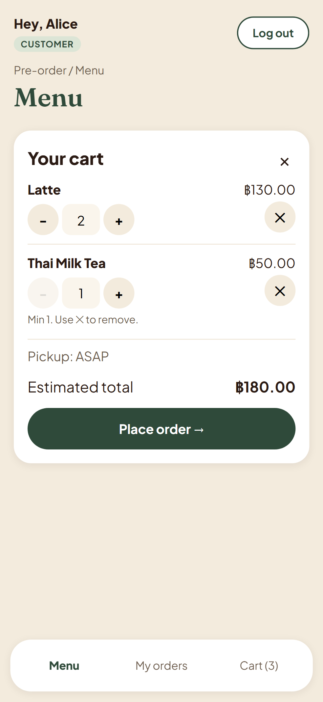
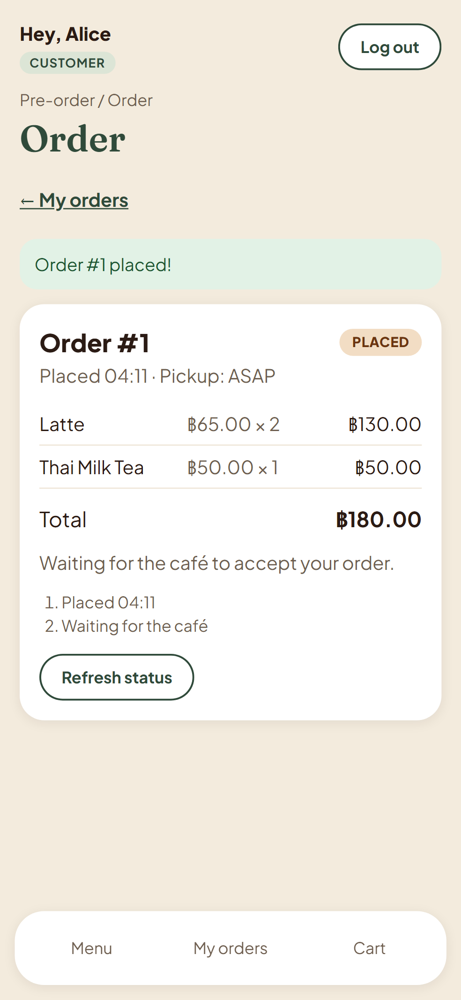
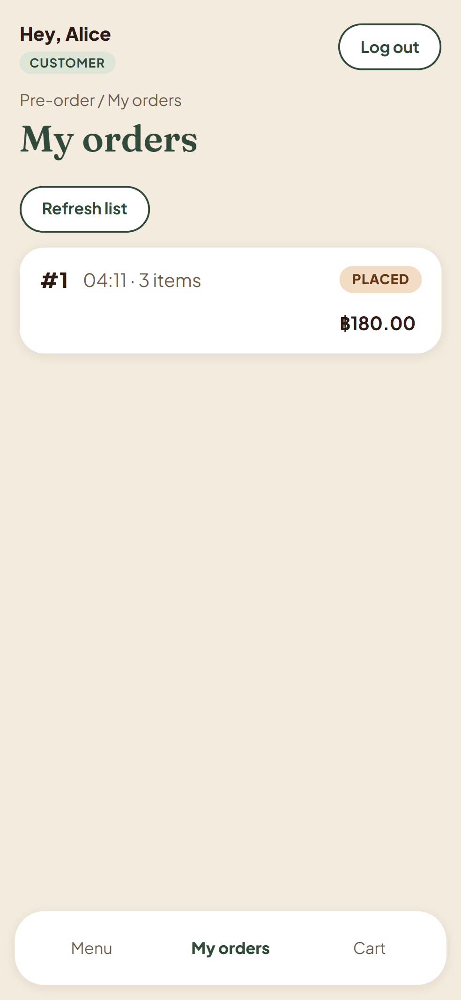

### Scenario 2 — Operator accepts the order (F-04)

| | |
|---|---|
| Feature / AC | F-04 AC-F04-11, AC-F04-12 (TEST-F04-11, TEST-F04-12) |
| Role | OPERATOR (staff) |
| Start | Two PLACED orders (alice 6 min ago, bob 2 min ago) |
| Steps | Log in as staff → queue → **Accept order** on the oldest |
| Expected | Queue oldest first, count 2; after accept: "Order #N accepted.", card gone, order ACCEPTED in the database |
| Actual | As expected |

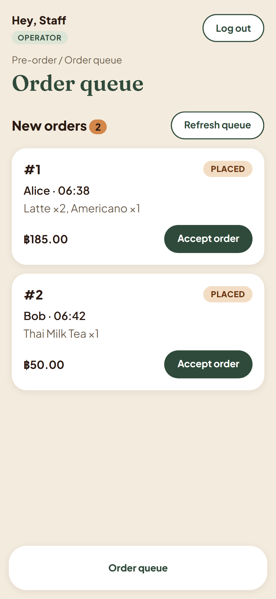
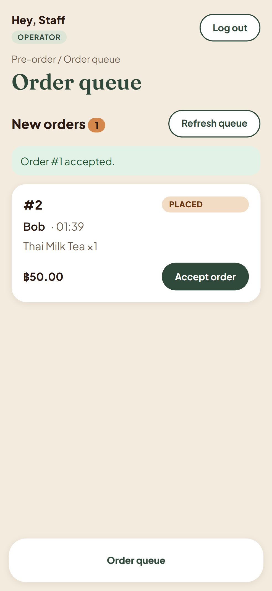

### Scenario 3 — Business-rule rejection (BR-03) and boundary (BR-07)

| | |
|---|---|
| Feature / AC | F-03 AC-F03-11 (TEST-F03-20); F-04 AC-F04-13 (TEST-F04-13) |
| Role | CUSTOMER (alice); OPERATOR (staff) |
| Start | (a) Latte in alice's cart, then Latte marked sold out; (b) order accepted by another staff member after the queue page loaded |
| Steps | (a) **Place order**; (b) **Accept order** on the stale card |
| Expected | (a) 400 → "Order not placed. 'Latte' is no longer available.", cart kept, line marked, **0 orders saved**; (b) 409 → "Order #1: Already accepted by another staff member.", list reloads |
| Actual | As expected; the test checks `order.count() = 0` in the database for (a) |

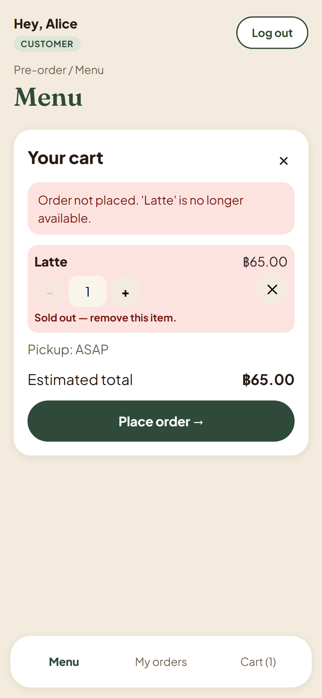
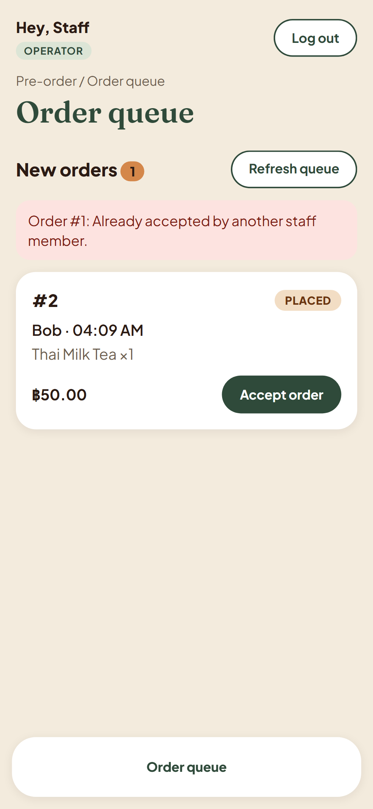

### Scenario 4 — Login, logout and a forbidden operation (F-01)

| | |
|---|---|
| Feature / AC | F-01 AC-F01-12, AC-F01-13, AC-F01-14 (TEST-F01-12..14); backend: AC-F01-10, AC-F03-09, AC-F04-09 |
| Role | anonymous → CUSTOMER (alice) → OPERATOR (staff) |
| Start | Logged out |
| Steps | Wrong password → right password → open `/operator/orders` as alice → log out → open `/menu` |
| Expected | "Incorrect email or password." (password cleared, email kept); alice lands on `/menu`; operator page → back to `/menu` with "You don't have access to that page."; after logout `/menu` → `/login` |
| Actual | As expected. Hiding the page is not the authorization: the API itself answers 403 to a customer on every operator endpoint and 404 for another customer's order (excerpt F.4.2) |

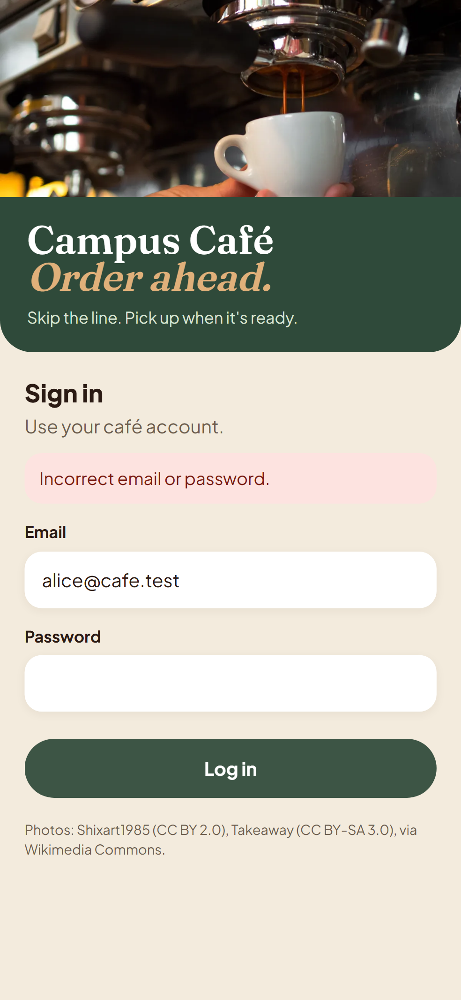
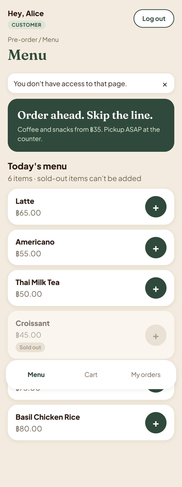

Desktop (1280 px) versions of every screenshot are in `docs/evidence/screenshots/*-desktop.png`, for example:

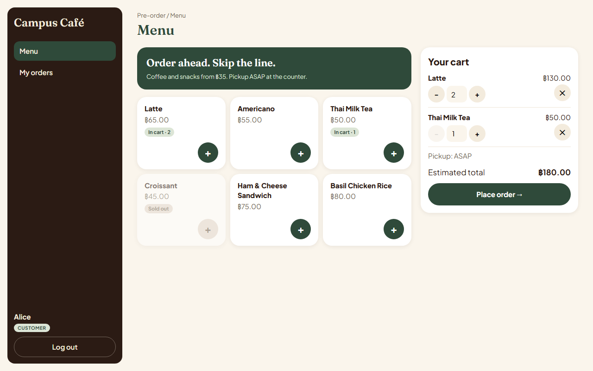
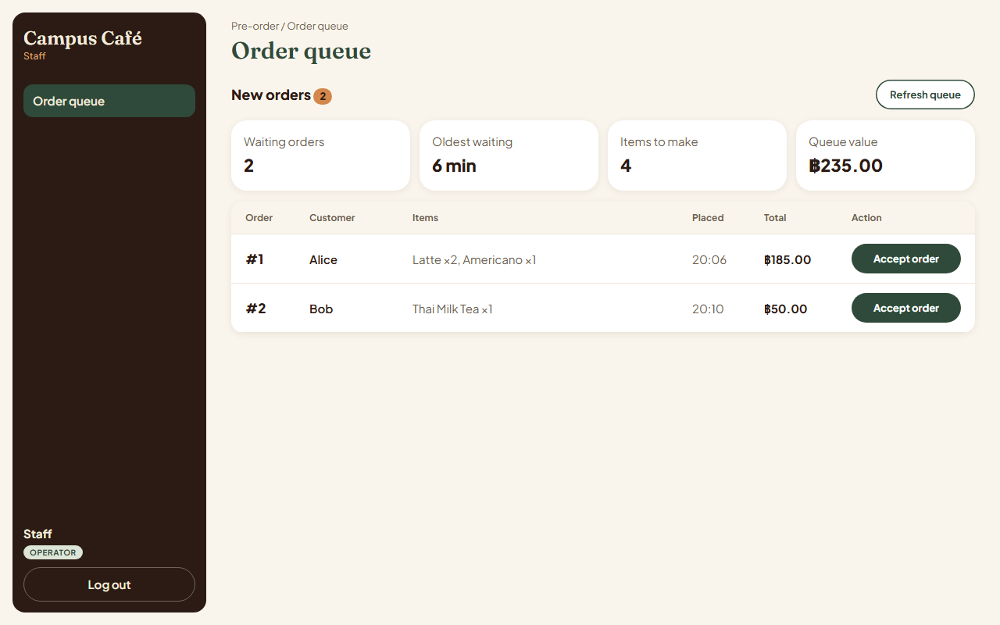

## F.3 Build and automated test results

All results below are **automated** tests. No manual check is counted as verification.

<!-- COUNTS -->
<!-- /COUNTS -->

Every single test with its result: `docs/evidence/test-run.md`.

### Acceptance criteria → planned test → actual test → result

<!-- AC-TABLE -->
<!-- /AC-TABLE -->

## F.4 Test excerpts

### F.4.1 Domain rule — BR-07: twenty accepts at the same time, exactly one wins

`server/tests/operator.test.ts` (TEST-F04-07, AC-F04-07). Setup: one PLACED order created in the test database.

```ts
it("TEST-F04-07 BR-07 twenty accepts at the same time: exactly one succeeds", async () => {
  const o = await makeOrder("alice@cafe.test", "PLACED");
  const results = await Promise.all(Array.from({ length: 20 }, () => accept(o.id)));
  const codes = results.map((r) => r.status).sort();
  expect(codes.filter((c) => c === 200)).toHaveLength(1);
  expect(codes.filter((c) => c === 409)).toHaveLength(19);
  expect(await statusOf(o.id)).toBe("ACCEPTED");
});
```

The code under test is one atomic conditional update (`server/src/operator/routes.ts`):

```ts
const { count } = await prisma.order.updateMany({
  where: { id, status: { in: statusesThatCanMoveTo("ACCEPTED") } },
  data: { status: "ACCEPTED", acceptedAt: new Date() },
});
```

| Version | Commit | Result (saved output) |
|---|---|---|
| Test written, no implementation `[red]` | `463f459` | **failed**: `AssertionError: expected [] to have a length of 1 but got +0` (`tdd/F-04-red.txt`) |
| Implementation `[green]` | `f729818` | **passed** (`tdd/F-04-green.txt`); passed 5 runs in a row and in every run since |

### F.4.2 Ownership restriction — another customer's order is not visible

`server/tests/orders.test.ts` (TEST-F03-14, AC-F03-08). Setup: bob places an order; alice (another customer) asks for it by id.

```ts
it("TEST-F03-14 another customer's order and a missing id both give the same 404", async () => {
  const bobs = await place(bob, { items: [{ menuItemId: menu["Latte"], quantity: 1 }] });
  const other = await get(alice, `/api/orders/${bobs.body.id}`);
  const missing = await get(alice, "/api/orders/99999");
  for (const res of [other, missing]) {
    expect(res.status).toBe(404);
    expect(res.body).toEqual({ error: { code: "NOT_FOUND", message: "Order not found.", details: null } });
  }
});
```

The server filters by owner inside the query, so no data from bob's order is ever loaded for alice (`server/src/orders/routes.ts`): `prisma.order.findFirst({ where: { id, customerId: req.user!.id } })`. Role checks work the same way: `requireRole("CUSTOMER")` / `requireRole("OPERATOR")` read the role from the session row, never from the request (TEST-F01-10, TEST-F03-16, TEST-F04-09).

| Version | Commit | Result (saved output) |
|---|---|---|
| Test written, no implementation `[red]` | `e922626` | **failed**: got the generic route 404 `"Not found."` instead of the specified `"Order not found."` (`tdd/F-03-red.txt`) |
| Implementation `[green]` | `13a2651` | **passed** (`tdd/F-03-green.txt`) |

## F.5 Engineering workflow and history

### Contract recorded before implementation

| Feature (owner) | Contract `[spec]` | Tests fail `[red]` | Code passes `[green]` | PR (reviewer) |
|---|---|---|---|---|
| F-01 Login (vieng) | `e187cf8` 03:35 | `d0d4eb9` 03:38 — 11 failed | `eebaf41` 03:39 — 11 passed | #22 (ninja) |
| F-02 Menu (ninja) | `6e25979` 03:35 | `3376cd3` 03:45 — 6 failed | `2816f63` 03:46 — 6 passed | #23 (vieng) |
| F-03 Orders (ninja) | `3178514` 03:36 | `e922626` 03:50 — 29 failed | `13a2651` 03:57 — 29 passed | #26 (vieng) |
| F-04 Accept (vieng) | `92470d8` 03:37 | `463f459` 03:46 — 10 failed | `f729818` 03:48 — 10 passed | #24 (ninja) |

Times are 6 Nov 2026, +07:00, from `git log`. Full Issue / branch / PR / reviewer table for every Issue: `docs/evidence/history.md`.

### Two completed Issues and their pull requests

| | Issue #5 — F-04 Operator queue and accept | Issue #4 — F-03 Place order, my orders, order detail |
|---|---|---|
| Contract | `docs/sprints/sprint-1/F-04-accept.md` (AC-F04-01..13, TEST-F04-01..13) | `docs/sprints/sprint-1/F-03-orders.md` (AC-F03-01..12, TEST-F03-01..21) |
| Branch (made from the Issue) | `feature/F-04-accept` | `feature/F-03-orders` |
| PR | #24 into `sprint-1` | #26 into `sprint-1` |
| Author → reviewer | vieng → ninja | ninja → vieng |
| Substantive review | Ran 34 + 1 tests and build; checked the atomic update for BR-06/07, the additive migration, the role guard; answered two design questions (desktop cards vs table → known UI debt) | Ran 63 + 5 tests, build, and the 16 E2E tests on top of the PR; checked BR-01..05 in code and tests; noted the row-lock limitation and comment style (fixed in #27) |
| Integration into staging | merged into `sprint-1`, merge commit `f7cabb1` | merged into `sprint-1`, merge commit `2244619` |
| Into `main` | at release (decided by vieng) | at release (decided by vieng) |

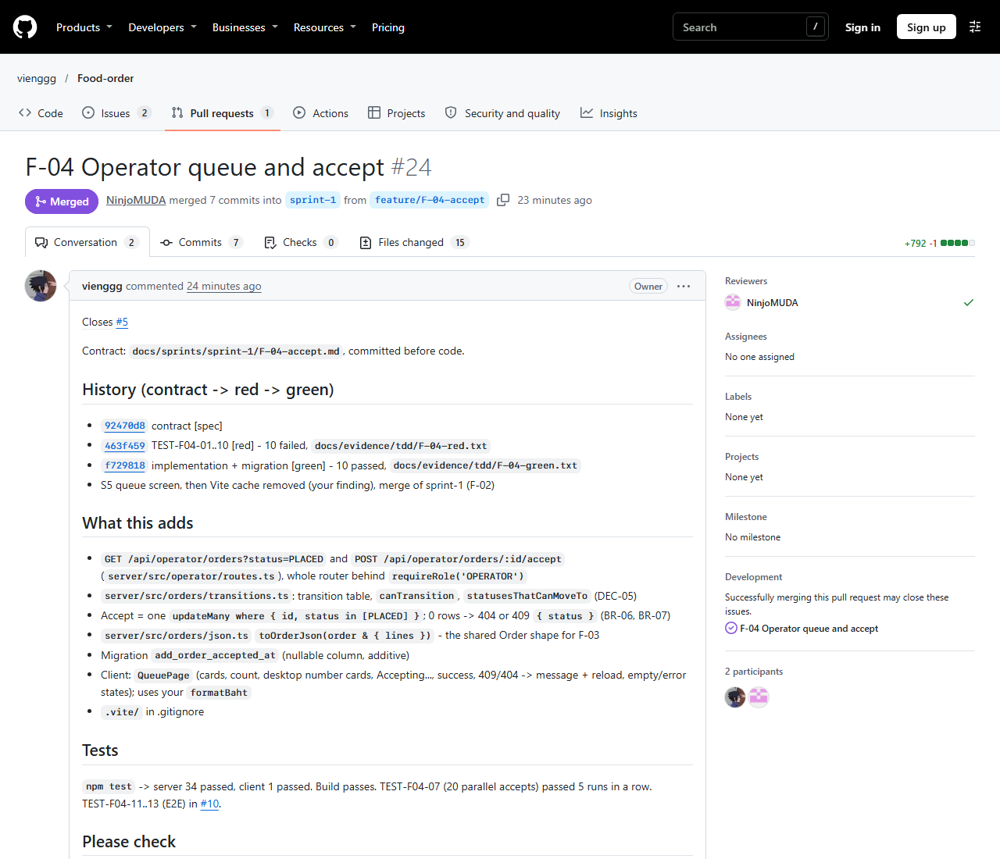
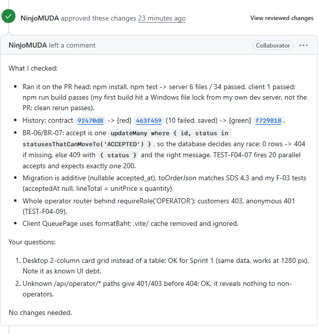
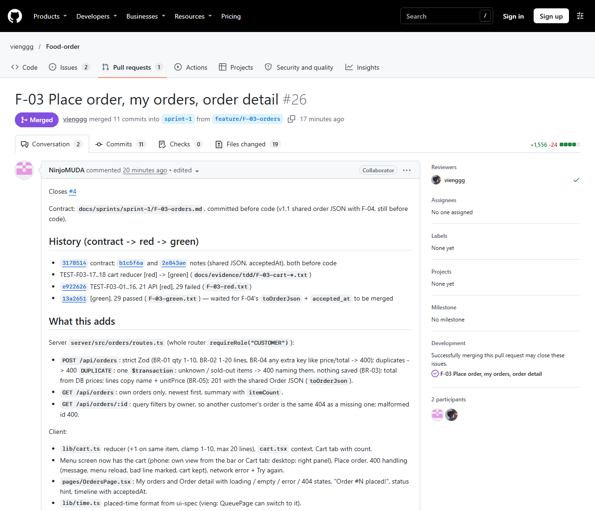
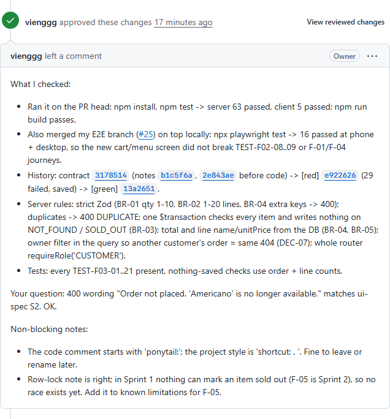

### Final board status

<!-- BOARD -->
<!-- /BOARD -->

## F.6 Contribution

| Area | vieng | ninja |
|---|---|---|
| Requirements and design | SRS (Doc A); SDS §1, 2, 5, 6, 7 (architecture, UI, roles, auth, config) | Feature inventory + traceability (Doc B); SDS §3, 4 (data model, API); sprint plan (Doc D) |
| Features (contract, tests, code) | Setup skeleton (#1), F-01 login, F-04 accept | F-02 menu, F-03 orders, client test setup |
| Testing and evidence | Playwright setup, E2E for F-01, F-02, F-04; evidence script; Part F | E2E for F-03; traceability results; PDF build |
| Reviews (approved and merged) | #16, #17, #21, #23, #26, #27, #29 | #18, #19, #20, #22, #24, #25, #30 |

Pair work: schema and seed (#1) were agreed together; shared code such as `requireRole`, `toOrderJson` and the order JSON shape were agreed in chat before either side wrote them.

## F.7 AI-use declaration

Both students used Claude Code (Anthropic) as a coding and documentation assistant, each in their own session, on bounded GitHub Issues with the feature contract as input. The AI drafted documents (SRS, SDS, plan, contracts, traceability), wrote the failing tests first and then the implementation, built the UI screens, ran the tests and produced this evidence. The two AI sessions coordinated through a private chat relay.

With each student's permission, each AI session also opened pull requests and **reviewed, approved and merged the other student's pull requests on that student's GitHub account**, after running the code and tests; the review text on each PR is the AI's written check. No session approved or merged a pull request written by its own student. Both students are responsible for the result and can explain the design, tests and released behaviour.

## F.8 Known limitations, incomplete work, failed and skipped tests

- **Failed / skipped tests:** none in the run in F.3 (counts above). No test was disabled or weakened.
- **Process exceptions (setup, documents only):** PRs #13 and #15 were merged by their author without review, and four commits were pushed directly by the repo owner (`5f85976`, `810c7e3`, `2797462`, `d92baf0`). Every PR from #16 on was reviewed and merged by the other student. Details: `history.md`.
- Branch `feature/F-03-e2e` is linked to Issue #10 through PR #27; the branch link under "Development" is added on the website.
- F-03 reads menu items without a row lock inside the order transaction. In Sprint 1 nothing changes availability while the app runs, so no race exists yet; revisit with F-05 (menu management).
- UI debt: desktop operator queue uses cards instead of a table; desktop My orders and Order detail are two pages instead of side by side.
- Not done yet: release to `main` and tag `v0.1.0-sprint1` (the students' decision); Docker image, CI/CD and GCP deployment (Lab 5).
