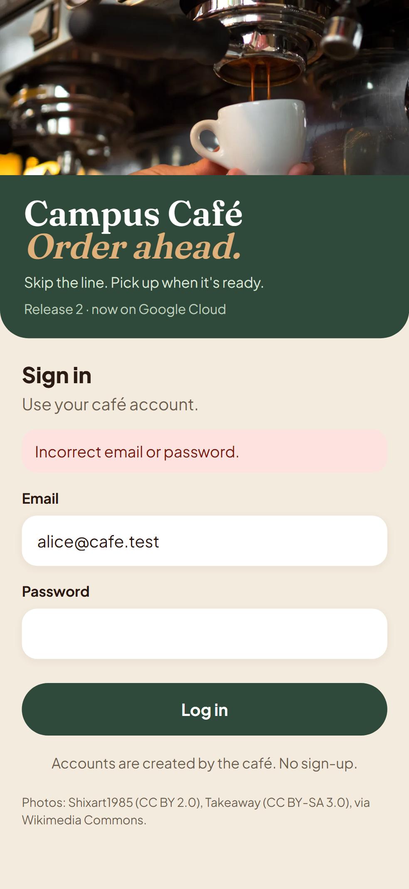
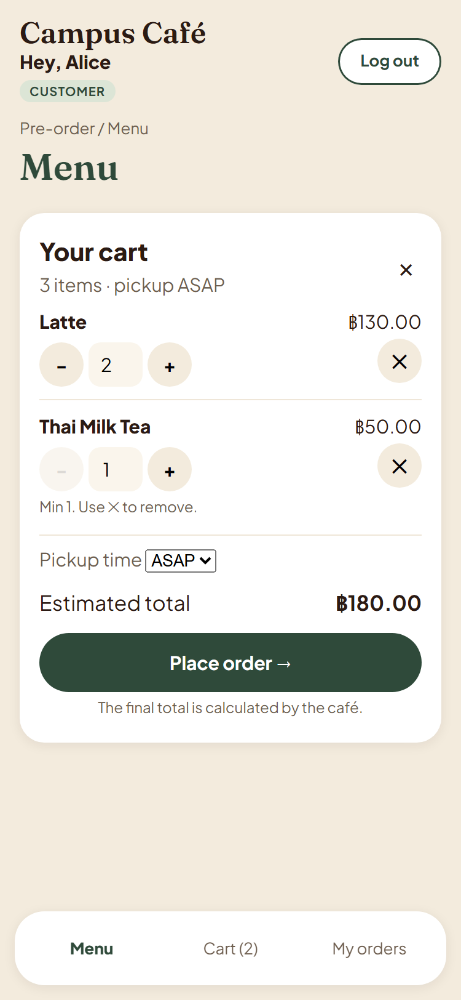
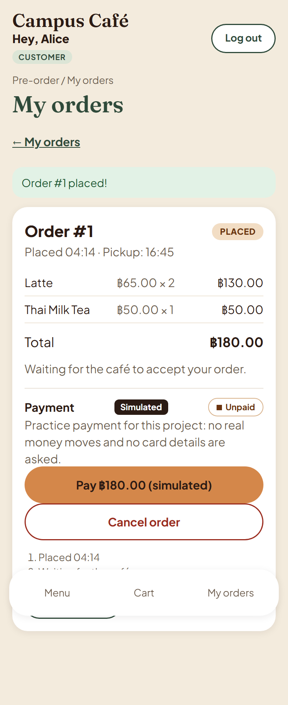
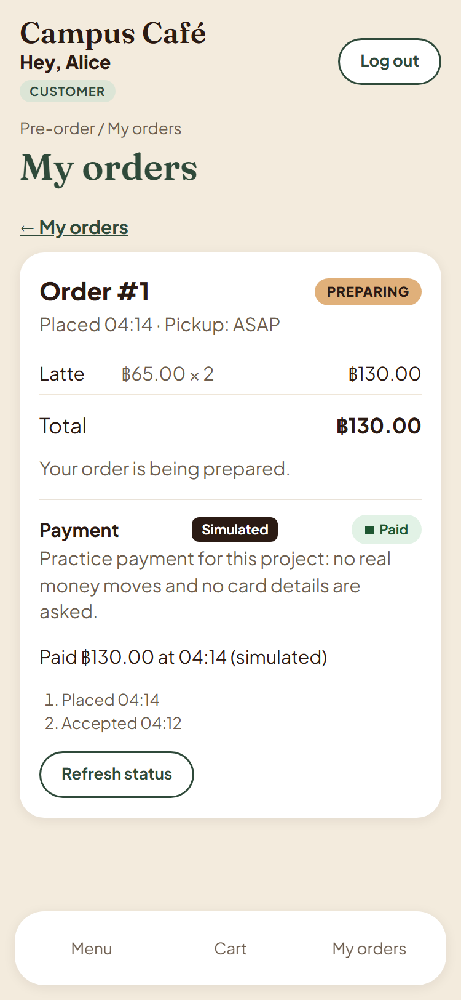
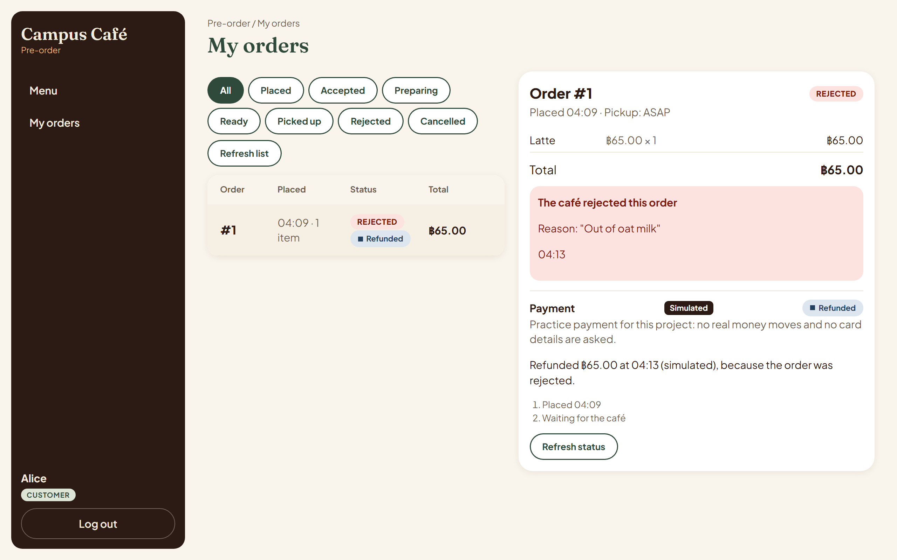
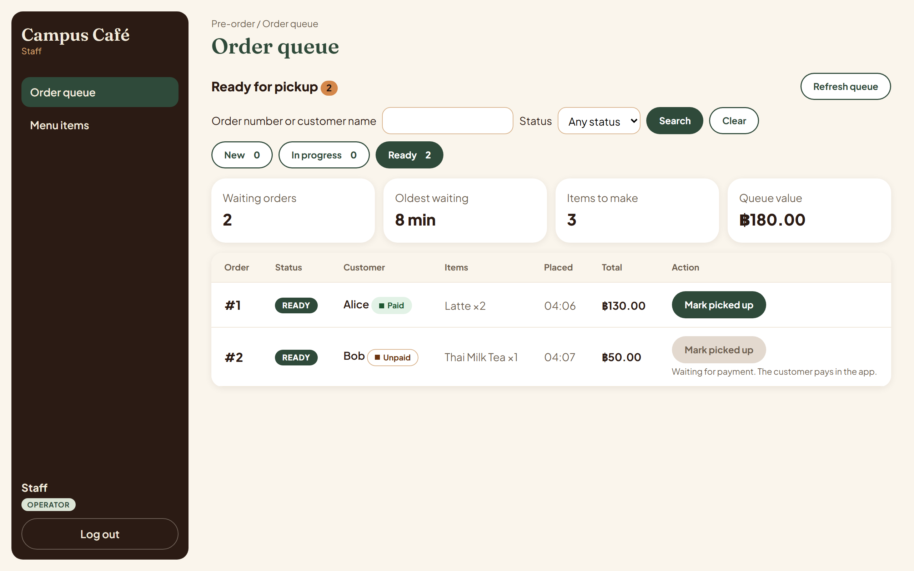
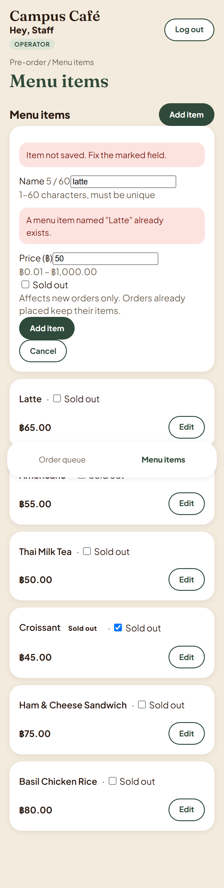
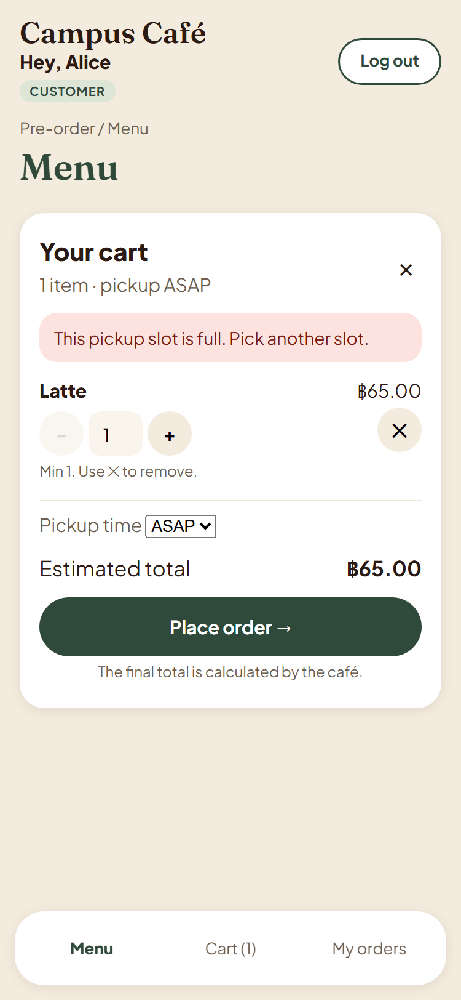
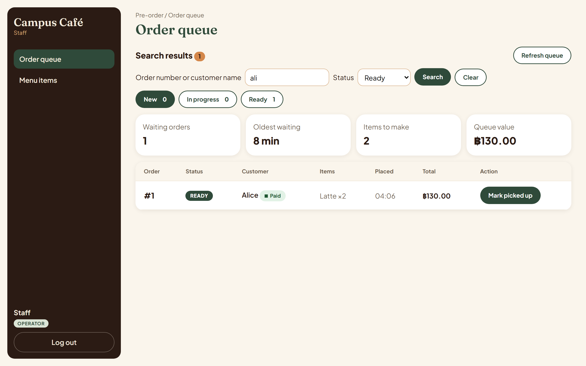
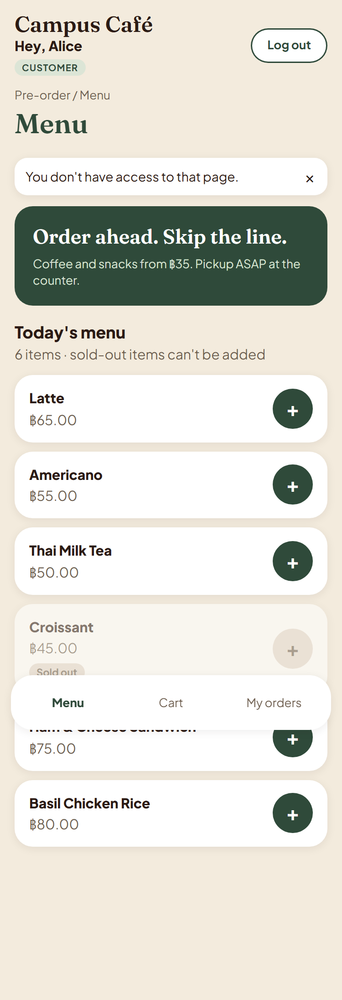

# Final Delivery Part A — Product overview, setup, and live demonstrations (draft)

Campus Café Pre-order — Team **Est** (`vienggd/Food-order`), Section **131**. Author: **vieng** (`vienggd`), Issue **#196**. Rubric: `project_final_delivery_v1.pdf` (local copy `docs/final_project_delivery.pdf`) §3.1 (35 pts).

> **Draft boundary notice:** All final-release `v1.0.0` verification, Cloud Run revision checks after Sprint 3 deploy, and unbuilt `F-10` / `F-12` UI demonstrations are explicitly marked **PENDING `v1.0.0`**. Implemented Sprint 1 (`main` `39bda5e`) and Sprint 2 + implemented Sprint 3 (`F-09` server/picker, `F-11` search/filter on `sprint2`) are backed by real observed test runs and unedited Chromium `@2x` screenshots.

## A.1 Final product summary and scope completion (`F-01`..`F-12`)

**Campus Café Pre-order** eliminates queue bottlenecks at a single campus café: students and staff sign in (`CUSTOMER`), browse live menu availability, assemble an itemized cart (`1–20` unique items, `1–10` per line, capped at `15` total items after Lab 7 `C-1`), select ASAP or a 15-minute Bangkok pickup window (`08:00–16:45`, 15-minute cut-off, capacity 10), pay (simulated), and track status changes (`PLACED -> ACCEPTED -> PREPARING -> READY -> PICKED_UP`), while café staff (`OPERATOR`) manage menu prices/availability, accept or reject orders (triggering automatic simulated refunds on paid orders), filter/search any of the 7 statuses, and track sales summaries.

| Sprint | Feature | Implementation state at draft (`sprint2` `__COMMIT__`) | Live `main` release state |
|---|---|---|---|
| **Sprint 1** | `F-01` Auth & role guards, `F-02` Menu, `F-03` Place Order & My Orders, `F-04` Operator Queue & Accept | Complete + `9/9` Lab 6 fixes verified | Released (`v0.1.0-sprint1` -> Lab 6 `39bda5e`, `food-order-00009-jd9`) |
| **Lab 7** | `C-1` Order item total limit (`max 15 items`, `BR` extension on `F-03`) | Complete on `lab7` (`66f2628`: server 78, client 7, E2E 26) | `PENDING` merge of `lab7` / `sprint2` -> `main` |
| **Sprint 2** | `F-05` Menu Admin, `F-06` Cancel & Reject, `F-07` Fulfilment, `F-08` Payment, `BR-15` & `BR-16` | Complete & verified on `sprint2` | `PENDING` `v0.2.0-sprint2` / `v1.0.0` |
| **Sprint 3** | `F-09` Pickup Slots + Cut-off (`FR-16`), `F-11` Search & Filter (`FR-18`) | Implemented on `sprint2` (`F-09` E2E picker tests `TEST-F09-15..17` pending) | `PENDING` `v1.0.0` |
| **Sprint 3** | `F-10` Sales Summary (`FR-17`), `F-12` Login Rate Limit (`NFR-08`) & A11y (`NFR-09`) | Specified in `docs/sprint_2/sprints/F-10..F-12.md`; code scheduled `29–30 Nov` | `PENDING` `v1.0.0` |

## A.2 Local reproduction & environment configuration

```bash
git clone https://github.com/vienggd/Food-order.git && cd Food-order
npm ci
cp server/.env.example server/.env           # set DATABASE_URL, TEST_DATABASE_URL, SEED_PASSWORD
docker compose up -d                         # starts PostgreSQL 16 on localhost:5433
npm run db:migrate && npm run db:seed        # applies Prisma migrations & synthetic accounts/menu
npm run dev                                  # UI on :5173, API on :3000
npm run build && npm test && npx playwright test
```

Seeded accounts (synthetic local/demo credentials): `alice@cafe.test` and `bob@cafe.test` (`CUSTOMER`), `staff@cafe.test` (`OPERATOR`). Secrets never live in Git; `CLOUD` runtime secrets (`food-order-database-url`, `food-order-seed-password`, `food-order-smoke-password`) are injected via GCP Secret Manager.

## A.3 Deployed architecture & durable Cloud SQL persistence check

Production runs at **`https://food-order-d4jdyxqbca-as.a.run.app`** (`asia-southeast1`): one stateless Docker container (`Express 5` + static `client/dist`) connecting via Unix socket to **Cloud SQL PostgreSQL 16** (`food-order-pg`). GitHub Actions workflow `.github/workflows/deploy.yml` builds and tags every `main` image by SHA, executes Prisma migrations in Cloud Run Job `food-order-migrate`, deploys the digest, and runs `deploy/smoke_test.py`.

**Durable data across re-deployment (rubric requirement):**

| Step | Evidence to collect on `v1.0.0` release | Status |
|---|---|---|
| 1. Pre-redeploy record | Place & pay an order on live `https://food-order-d4jdyxqbca-as.a.run.app` before the final redeploy; capture Order ID, total, and `PAID` status screenshot | **PENDING `v1.0.0`** |
| 2. Redeploy new Cloud Run revision | Trigger final release merge (`v1.0.0`) or revision rollout; record new Cloud Run revision name and `/api/ready` (`database: connected`) output | **PENDING `v1.0.0`** |
| 3. Post-redeploy read-back | Reload the live app, open **My orders** and **Operator queue** / **Sales summary**, confirm the exact pre-redeploy order & payment record persists identically | **PENDING `v1.0.0`** |

*(Prior precedent from Lab 6: EN-009_P3 / Vieng already confirmed durable persistence on live Cloud SQL across revision rollouts during Lab 6 `UAT-04` step 9.)*

## A.4 End-to-end demonstrations (current implemented flows + pending Sprint 3 screens)

All screenshots below are real Chromium `@2x` captures (`deviceScaleFactor: 2`, `0 px` horizontal overflow).

### Demo 1 — Sprint 1 Auth, Menu, Order Placement + `F-09` Pickup Slot & `BR-03` Validation

1. Invalid login (`F-01`) rejects without revealing account existence (`Incorrect email or password.`); `alice` logs into `/menu` where sold-out `Croissant` cannot be added (`BR-03`).
2. `alice` adds `Latte ×2` + `Thai Milk Tea ×1`, selects today pickup slot `16:45` (`F-09`), and places the order -> server calculates `฿180.00` (`BR-04`) and saves `Pickup: 16:45`.





### Demo 2 — Sprint 2 Simulated Payment (`F-08`), Cancel/Reject + Refund (`F-06`, `BR-16`), and Fulfilment Table (`F-07`, `BR-15`)

1. **Payment (`F-08`):** Customer pays `฿130.00` via Simulated Payment (zero card inputs); `■ Paid` persists across reload.
2. **Rejection + automatic refund (`F-06` + `BR-16`):** Operator rejects a `PAID` order with reason `"Out of oat milk"` -> customer sees exact reason and `Refunded ฿65.00 ... (simulated)`.
3. **Fulfilment + Payment Guard (`F-07` + `BR-15`):** Desktop queue (`7` aligned columns) enables **Mark picked up** on PAID orders while disabling it on UNPAID orders with `"Waiting for payment. The customer pays in the app."`.





### Demo 3 — Operator Menu Management (`F-05`), `BR-08` Duplicate Rejection, & Sprint 3 Slot Capacity / Search (`F-09 BR-24`, `F-11`)





### Demo 4 — Unauthorized Access Prevention (`FR-04`, `NFR-02`)

Customer `alice` attempting to open `/operator/menu` in the UI is redirected to `/menu` (`"You don't have access to that page."`); direct API probes enforce `401 UNAUTHENTICATED` (anonymous), `403 FORBIDDEN` (customer on `/api/operator/*`), and `404 NOT_FOUND` (customer on another customer's order). See **Part B** & **Deliverable 2 Part B** for full probe logs.



### Demo 5 — Final Sprint 3 Features on Live `v1.0.0` (`F-10` Sales Summary, `F-12` Rate Limit & A11y, Lab 7 `15-item` Cap Live Check)

| Pending Demo Item | Contract & Verification Target | Status |
|---|---|---|
| `F-10` Sales Summary (`/operator/sales`) | Daily order count + `PAID & PICKED_UP` revenue total (Asia/Bangkok) + Top 3 items (`AC-10.1..10.9`) | **PENDING `v1.0.0`** |
| `F-12` Login Rate Limit (`POST /api/auth/login`) | 6th consecutive failed login for one email returns `429 RATE_LIMITED` + lockout banner (`BR-20`, `BR-21`, `NFR-08`) | **PENDING `v1.0.0`** |
| Lab 7 `C-1` Max 15 Items on Live URL | Live Cloud Run UI & `400 VALIDATION_ERROR` rejection at 16 total items | **PENDING `v1.0.0`** |
| Live `v1.0.0` Cloud Run E2E Walkthrough | Updated screenshots on `https://food-order-d4jdyxqbca-as.a.run.app` replacing staging screenshots above | **PENDING `v1.0.0`** |
