# Lab 5 — Food-order on Google Cloud with CI/CD

CPE 334 · Semester 1/2026 · Group lab (same team and repository as the Group Project).
This PDF is an evidence index: each item gives a direct link and one or two sentences. Screenshots are used
only where a link cannot show the result, cropped to the part that matters; no secret is shown in any of them.

## Answer Part 0: Team and Evidence Index

| | |
|---|---|
| Team / topic | Team 33 — Theme 4 E-Commerce / Ordering: **Campus Café Pre-order** (Food-order) |
| Students | **Garunyapas Danpitakkul** (vieng) — 67070503404 — GitHub [`vienggd`](https://github.com/vienggd)<br>**Dechayut Panyawutvorakul** (ninja) — 67070503414 — GitHub [`NinjoMUDA`](https://github.com/NinjoMUDA) |
| Repository (public) | https://github.com/vienggd/Food-order |
| Submitted release | Commit [`ca0ce13`](https://github.com/vienggd/Food-order/commit/ca0ce13bf18a4cd5f53e1f9d7972641080a62b01) on `main` (release PR [#82](https://github.com/vienggd/Food-order/pull/82)) |
| Public URL | https://food-order-d4jdyxqbca-as.a.run.app — serving commit `ca0ce13` (Deploy demo run [45029701876](https://github.com/vienggd/Food-order/actions/runs/45029701876), revision `food-order-00003-f9z`) |
| GCP | Project `cpe334-2026-team33`, region `asia-southeast1`. Owner: vieng; ninja: Editor |
| Staging / board | Staging branch `lab-5`; label `lab5` on every Lab 5 Issue and PR; board https://github.com/users/vienggd/projects/4 |

### Contribution

Every PR went into `lab-5` (or `lab-5` → `main` for a release) and was reviewed and merged by the other student with a merge commit.

| Issue | Work | Owner | Reviewer | PR(s) |
|---|---|---|---|---|
| [#61](https://github.com/vienggd/Food-order/issues/61) | Lab 5 plan | vieng | ninja | [#72](https://github.com/vienggd/Food-order/pull/72) |
| [#62](https://github.com/vienggd/Food-order/issues/62) | GCP Free Trial, project, budget alert, ninja as Editor | vieng | ninja | Console (evidence in this report) |
| [#63](https://github.com/vienggd/Food-order/issues/63) | Cloud-ready app: `/api/ready`, React served by Express, env-only config | ninja | vieng | [#76](https://github.com/vienggd/Food-order/pull/76) |
| [#64](https://github.com/vienggd/Food-order/issues/64) | One Docker image, `.dockerignore`, compose (db + migrate + app) | ninja | vieng | [#77](https://github.com/vienggd/Food-order/pull/77) |
| [#65](https://github.com/vienggd/Food-order/issues/65) | CI `test-and-docker`, deploy scripts + their tests, `deployment.md` | vieng | ninja | [#74](https://github.com/vienggd/Food-order/pull/74) |
| [#66](https://github.com/vienggd/Food-order/issues/66) | First deploy (`deploy/deploy.sh`), Cloud SQL, secrets | vieng | ninja | Cloud (evidence in Part 3) |
| [#67](https://github.com/vienggd/Food-order/issues/67) | Keyless GitHub → GCP (WIF), `demo` environment, ruleset; prove the gate | vieng (setup), ninja (gate) | other | [#79](https://github.com/vienggd/Food-order/pull/79) (gate, not merged) |
| [#68](https://github.com/vienggd/Food-order/issues/68) | `deploy.yml` + smoke test; visible change | ninja (`deploy.yml`), vieng (visible change) | other | [#75](https://github.com/vienggd/Food-order/pull/75), [#81](https://github.com/vienggd/Food-order/pull/81) |
| [#69](https://github.com/vienggd/Food-order/issues/69) | Persistence, restart, rollback and roll forward | ninja | vieng | Deploy demo runs (Part 3) |
| [#70](https://github.com/vienggd/Food-order/issues/70) | Evidence and this report | both | — | __REPORT_PR__ |
| [#71](https://github.com/vienggd/Food-order/issues/71) | Agent rule files name `lab-5` as staging | vieng | ninja | [#73](https://github.com/vienggd/Food-order/pull/73) |
| — | Releases `lab-5` → `main` | vieng (opened) | ninja (approved, merged) | [#78](https://github.com/vienggd/Food-order/pull/78), [#80](https://github.com/vienggd/Food-order/pull/80), [#82](https://github.com/vienggd/Food-order/pull/82) |

### Evidence index

| Rubric part | Artifact / direct link | IDs / version | Verification result |
|---|---|---|---|
| 1. CI and quality gate | PR [#74](https://github.com/vienggd/Food-order/pull/74) + run [45006187151](https://github.com/vienggd/Food-order/actions/runs/45006187151) | C-01, commit `e9b1bf8` | `test-and-docker` passed: 71 server + 6 client tests, deploy-script tests, build, `docker build` |
| 1. CI and quality gate | PR [#79](https://github.com/vienggd/Food-order/pull/79) from `test/prove-gate` + run [45027958632](https://github.com/vienggd/Food-order/actions/runs/45027958632); ruleset `protect-main` | C-02 (R-06), commit `0853d5b` | Check failed (1 failed / 70 passed); merge blocked; PR closed unmerged |
| 2. Docker and config | `Dockerfile`, `.dockerignore`, `docker-compose.yml`, `server/.env.example`, `deployment.md` | C-03, commit `6cace22` | Fresh clone → `docker compose --profile app up --build` → migrate exit 0, `/api/ready` = connected |
| 3. GCP deployment | Public URL; live API checks; Figures @c04-first–@c04-last | C-04, release `ca0ce13` | Sign in, place an order, staff accepts it; sold-out item rejected; customer gets 403 on the operator queue |
| 3. GCP deployment | Persistence figures; restart + rollback runs | C-05, releases `6cace22` / `ca0ce13` | Order #1 unchanged after restart (00004), rollback (run 45034802615) and roll forward (run 45034922682) |
| 4. Release pipeline | Issue [#68](https://github.com/vienggd/Food-order/issues/68) → PR [#81](https://github.com/vienggd/Food-order/pull/81) → release PR [#82](https://github.com/vienggd/Food-order/pull/82) → run [45029701876](https://github.com/vienggd/Food-order/actions/runs/45029701876) | C-06, commit `ca0ce13` | Service image digest = run summary digest; release note visible on the URL |

## Answer Part 1: CI and Quality Gate

**CI workflow.** [`.github/workflows/ci-docker.yml`](https://github.com/vienggd/Food-order/blob/main/.github/workflows/ci-docker.yml), job **`test-and-docker`**, runs on every PR into `lab-5` and `main` (and is reused by `deploy.yml` before every deploy): deploy-script tests (`bash -n`, stub tests, `test_smoke.py`) → `npm ci` → `npm test` (server tests against a real PostgreSQL 16 service container, client tests) → `npm run build` → `docker build .`.

**C-01 passing PR.** PR [#74](https://github.com/vienggd/Food-order/pull/74) (CI + deploy scripts), run [45006187151](https://github.com/vienggd/Food-order/actions/runs/45006187151): server 8 files / **71 tests passed**, client 3 files / **6 tests passed**, build and `docker build` OK. The same check passed on every later PR (e.g. release PRs [#78](https://github.com/vienggd/Food-order/pull/78), [#80](https://github.com/vienggd/Food-order/pull/80), [#82](https://github.com/vienggd/Food-order/pull/82)).

**Required check on `main`.** Ruleset `protect-main` (id 27842338), read back from the GitHub API:

```
name: protect-main   enforcement: active   target: ~DEFAULT_BRANCH (main)   bypass_actors: [] (nobody)
rules: deletion · non_fast_forward · pull_request (1 approving review)
       required_status_checks: test-and-docker (GitHub Actions), strict = branch must be up to date
```

**C-02 blocked PR.** PR [#79](https://github.com/vienggd/Food-order/pull/79) from the temporary branch `test/prove-gate` breaks AC-1.4 on purpose (`/api/health` expected `{ ok: false }`). Run [45027958632](https://github.com/vienggd/Food-order/actions/runs/45027958632) failed (1 failed, 70 passed) and GitHub blocked the merge (`mergeStateStatus = BLOCKED`); the PR was closed without merging.

__C02_MERGE_FIGURE__

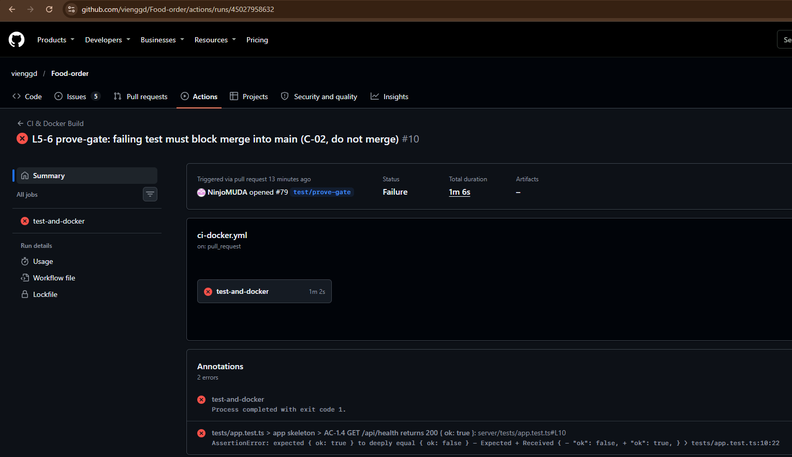

## Answer Part 2: Docker and Reproducible Configuration

**Image.** [`Dockerfile`](https://github.com/vienggd/Food-order/blob/main/Dockerfile) (two stages, Node 24 alpine, non-root user, port 3000): one image serves the API and the built React app; the same image runs the migration job. [`.dockerignore`](https://github.com/vienggd/Food-order/blob/main/.dockerignore) keeps `.env`, `node_modules` and build output out of the build context. [`docker-compose.yml`](https://github.com/vienggd/Food-order/blob/main/docker-compose.yml) profile `app` = PostgreSQL 16 + one-shot migrate/seed + app.

**C-03 fresh clone** (commit `6cace22`, run on vieng's laptop, output shortened; the seed password is a local value and not shown):

```
$ git clone https://github.com/vienggd/Food-order.git && cd Food-order    # HEAD 6cace22
$ SEED_PASSWORD=<local value> docker compose --profile app up --build -d
$ docker compose --profile app ps -a
food-order-app-1       Up                        0.0.0.0:3000->3000/tcp
food-order-db-1        Up (healthy)              0.0.0.0:5433->5432/tcp
food-order-migrate-1   Exited (0)
$ curl http://localhost:3000/api/health      {"ok":true}
$ curl http://localhost:3000/api/ready       {"status":"ready","db":"connected"}
$ curl http://localhost:3000/                <title>Campus Café</title>
$ docker compose --profile app logs migrate  All migrations have been successfully applied. … Seed done: 3 users, 6 menu items.
```

**Configuration.** Every setting comes from environment variables: [`server/.env.example`](https://github.com/vienggd/Food-order/blob/main/server/.env.example) (placeholders only) and the table in [`deployment.md` → Environment variables](https://github.com/vienggd/Food-order/blob/main/docs/labs/lab-05/deployment.md#environment-variables) (purpose, secret or not, where the value comes from). On Cloud Run, `DATABASE_URL`, `SEED_PASSWORD` and `SMOKE_PASSWORD` come from Secret Manager (Figure @secrets); GitHub's secret scanning with push protection is on. `.env` is in `.gitignore` and `.dockerignore`.

## Answer Part 3: GCP Deployment and Persistence

**Service.** Cloud Run `food-order` (public, min 0 / max 3 instances, 512 MiB) runs as the service account `food-order-runner`, whose only project role is **Cloud SQL Client** (Figure @iam); it reads the three secrets by name. Database: Cloud SQL `food-order-pg`, PostgreSQL 16, Enterprise, `db-f1-micro`, 10 GB SSD with **automatic storage increase disabled** (Figure @sql). Migrations and seed run in the Cloud Run job `food-order-migrate` before the service changes. First created with [`deploy/deploy.sh`](https://github.com/vienggd/Food-order/blob/main/deploy/deploy.sh) from `main` `e3a4a84` (dry run checked first).

**UI, API and database connectivity** (live URL, 22 Nov 2026; the smoke-test password is read from Secret Manager and never printed):

```
GET  /api/health                         200 {"ok":true}
GET  /api/ready                          200 {"status":"ready","db":"connected"}
GET  /api/menu            (no session)   401 UNAUTHENTICATED
POST /api/auth/login      smoke@cafe.test 200 {"id":4,"name":"Smoke Test","role":"CUSTOMER"}
GET  /api/operator/orders (customer)     403 FORBIDDEN "You don't have access to this."
POST /api/operator/orders/1/accept (customer) 403 FORBIDDEN
POST /api/auth/logout                    204;  GET /api/auth/me afterwards → 401
```

Every Deploy demo run ends with [`deploy/smoke_test.py`](https://github.com/vienggd/Food-order/blob/main/deploy/smoke_test.py): health, ready, the React page, then login → `/api/menu` (6 items) → logout.

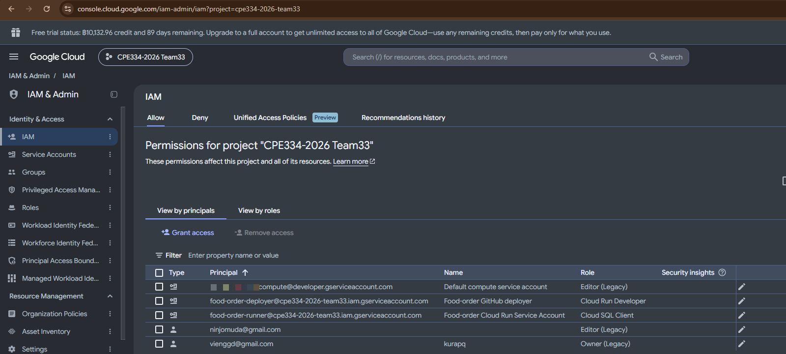

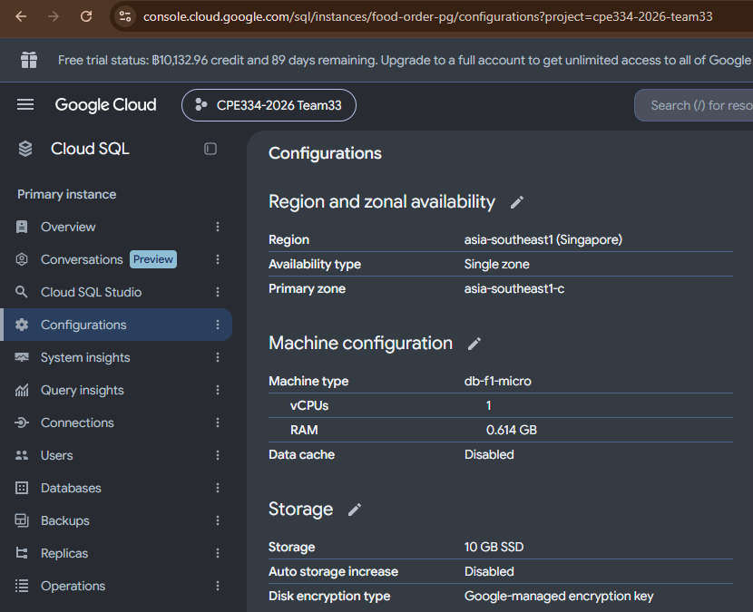

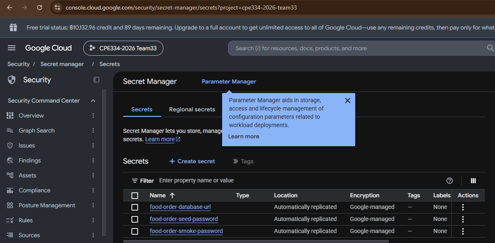

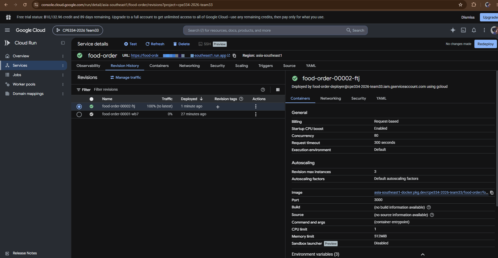

**C-04 live workflow** (URL bar visible in each figure):

__C04_FIGURES__

**C-05 persistence.** One order, checked through the API after each change (smoke-test customer; full log in [`evidence/c05-api-log.txt`](evidence/c05-api-log.txt)). Data lives in Cloud SQL, so replacing the containers does not touch it.

| Step (22 Nov 2026, UTC) | How | Running revision / image | Order #1 |
|---|---|---|---|
| 14:47 place order | `POST /api/orders` 2 × Latte → **201**, id 1, total 13000 satang | `food-order-00003-f9z` · `3516ec33…` (release #3) | created `14:47:26.304Z`, `PLACED` |
| 14:48 restart | `gcloud run services update food-order --update-labels=restarted=c05` (new revision, same image, all instances replaced) | `food-order-00004-rq6` · `3516ec33…` | same id, lines, total, `createdAt` |
| 14:49 rollback | Deploy demo [45034802615](https://github.com/vienggd/Food-order/actions/runs/45034802615), `image_tag = 6cace22…` (tests, build, migration skipped) | `food-order-00005-hj2` · `5f88cada…` (release #2, no release note) | same |
| 14:51 roll forward | Deploy demo [45034922682](https://github.com/vienggd/Food-order/actions/runs/45034922682), `image_tag = ca0ce13…` | `food-order-00006-9zh` · `3516ec33…` (release note back) | same |

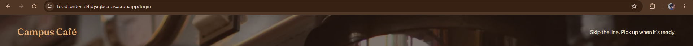

## Answer Part 4: Repeatable Release Pipeline

**One labelled change.** Issue [#68](https://github.com/vienggd/Food-order/issues/68) (label `lab5`) → branch `feature/L5-7-deploy-proof` made from the Issue → E2E test `TEST-L5-7` first (failed), then the release note on the login page → PR [#81](https://github.com/vienggd/Food-order/pull/81) into `lab-5`: CI green, ninja's review ("ran TEST-L5-7 locally: 2 passed, phone + desktop"), merge commit → release PR [#82](https://github.com/vienggd/Food-order/pull/82) `lab-5` → `main`: CI green, ninja's approval, merge commit `ca0ce13` → **Deploy demo** run [45029701876](https://github.com/vienggd/Food-order/actions/runs/45029701876) on the push to `main`.

**Pipeline.** [`.github/workflows/deploy.yml`](https://github.com/vienggd/Food-order/blob/main/.github/workflows/deploy.yml): reuses `test-and-docker` → signs in to Google **without a key** (Workload Identity Federation; the provider only accepts repository id 1447350368, branch `main`, workflow `deploy.yml`, environment `demo`) → builds and pushes the image tagged with the full commit SHA → [`deploy/release.sh`](https://github.com/vienggd/Food-order/blob/main/deploy/release.sh) resolves the digest, runs the migration job, then points the service at that digest with 100% traffic → smoke test on the public URL. The deployer account `food-order-deployer` has no keys (Figure @keys). Release #2 (run [45028498466](https://github.com/vienggd/Food-order/actions/runs/45028498466), `6cace22`) went through the same path.

**C-06 running revision = release commit.**

```
$ gcloud run services describe food-order --region asia-southeast1     --format='value(status.latestReadyRevisionName,spec.template.spec.containers[0].image,status.traffic[0].percent)'
food-order-00003-f9z  …/food-order/food-order@sha256:3516ec33e51f2b0697df7e3739d76cc992576a46abb7d28198483ab9ed79fef7  100

Deploy demo run 45029701876 (push of ca0ce13 to main):
  docker push   ca0ce13bf18a4cd5f53e1f9d7972641080a62b01: digest: sha256:3516ec33e51f…ed79fef7
  summary       Commit image tag: ca0ce13bf18a4cd5f53e1f9d7972641080a62b01
                Digest: …/food-order/food-order@sha256:3516ec33e51f…ed79fef7
  release.sh    revision [food-order-00003-f9z] … serving 100 percent of traffic
  smoke test    PASS /api/health, /api/ready, /, login + /api/menu (6 items), logout
```

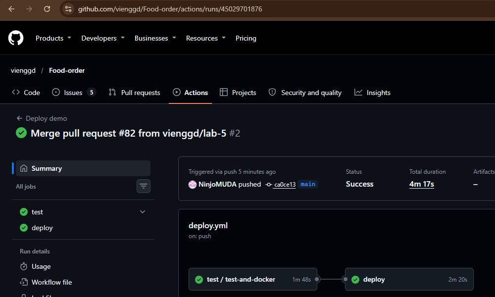

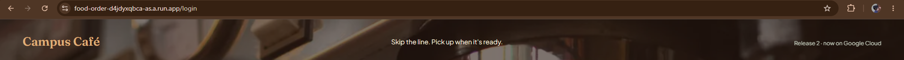

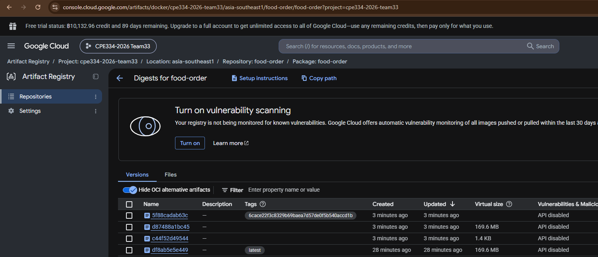

**Release procedure, which commit is running, rollback:** [`deployment.md` → Release procedure](https://github.com/vienggd/Food-order/blob/main/docs/labs/lab-05/deployment.md#release-procedure).

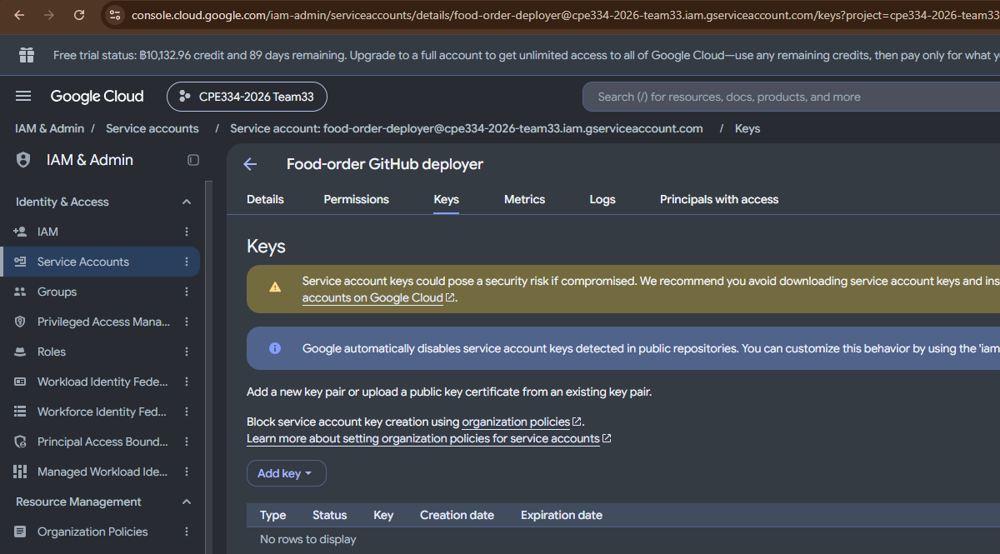

### Appendix: GCP account checks (Issue #62)

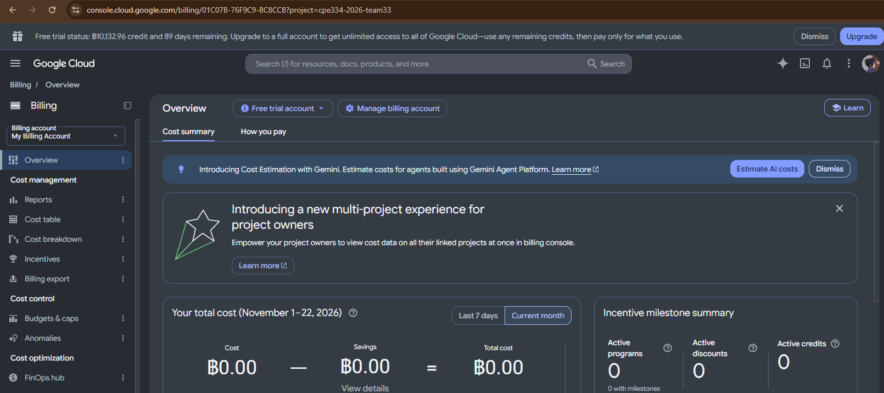

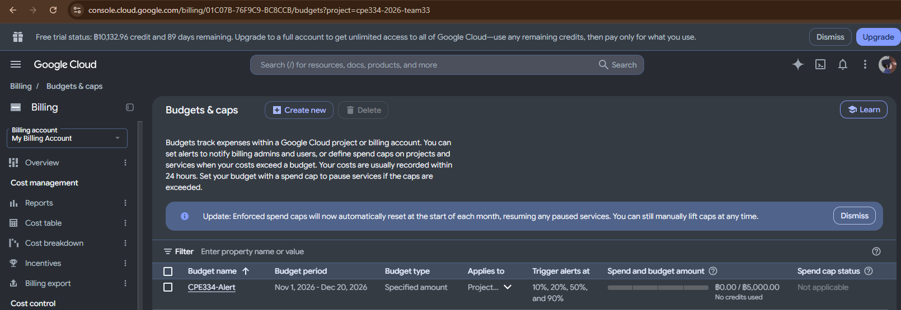

### Use of AI

Both students used Claude Code as a coding and operations assistant, each in their own session; the two sessions coordinated through a private chat relay. The AI wrote code and tests, ran the Cloud setup scripts with the project owner signed in, and collected this evidence. Passwords and keys were never typed by the AI or shown to it: deploy scripts generate them into Secret Manager, and GitHub uses keyless sign-in. Every PR was reviewed and merged by the other student's side; no side approved its own PR. Both students can explain every step.
