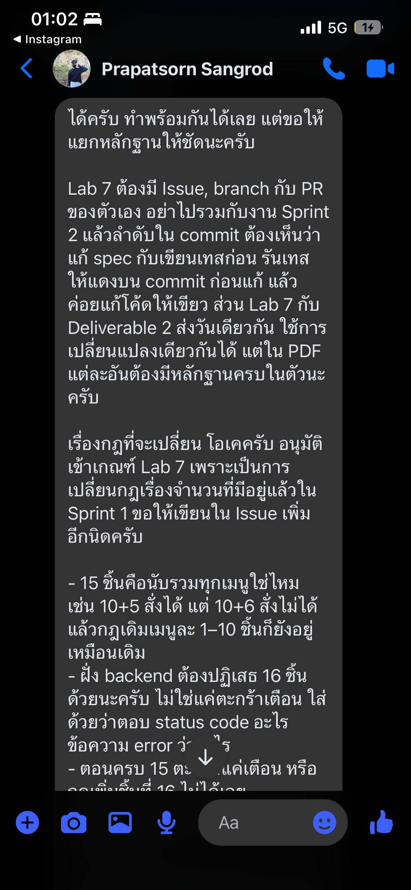
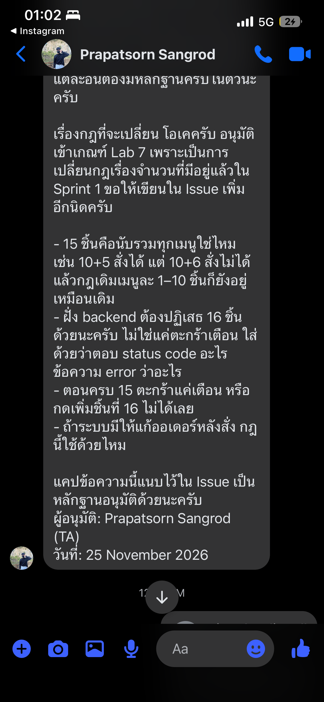
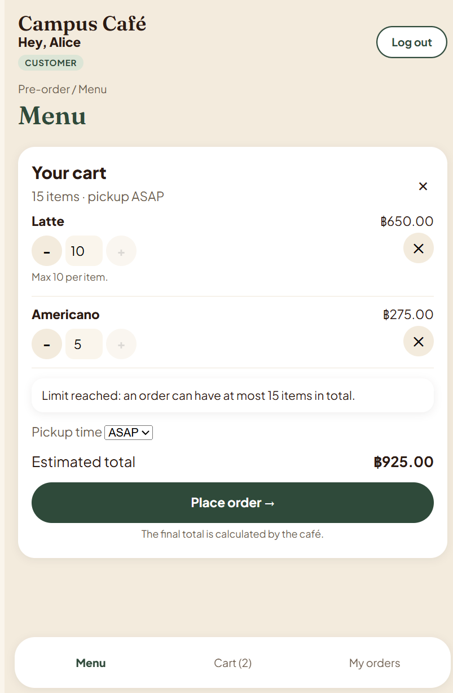
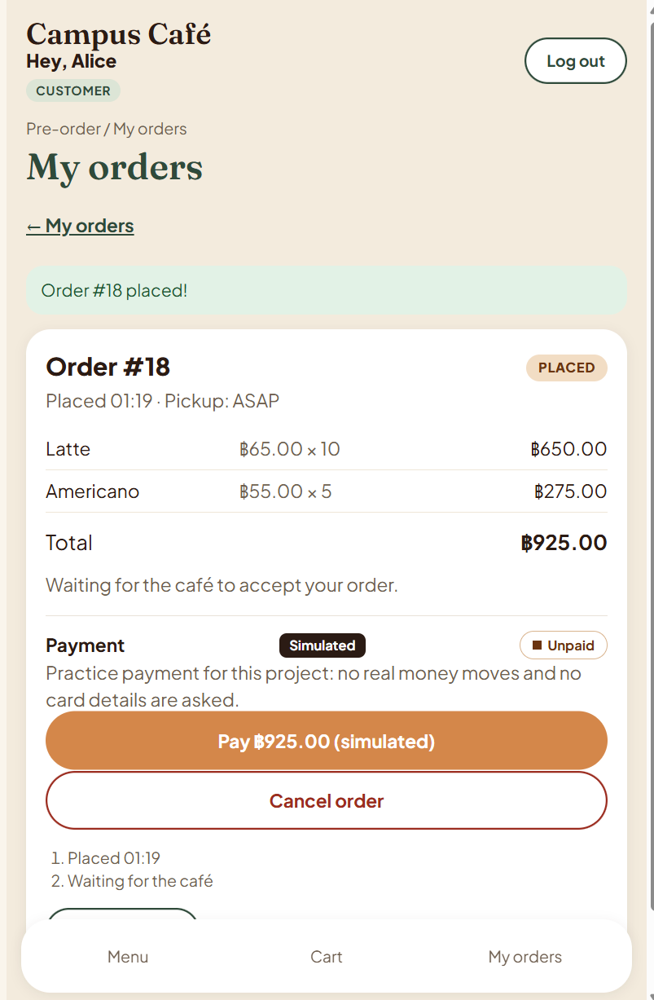
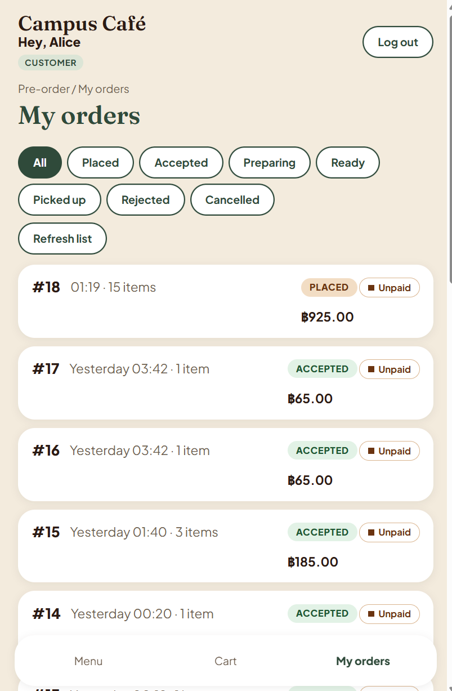
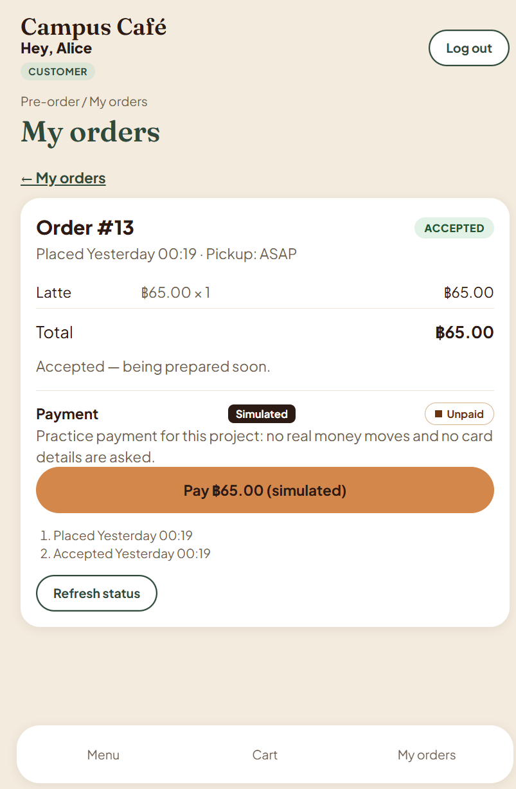
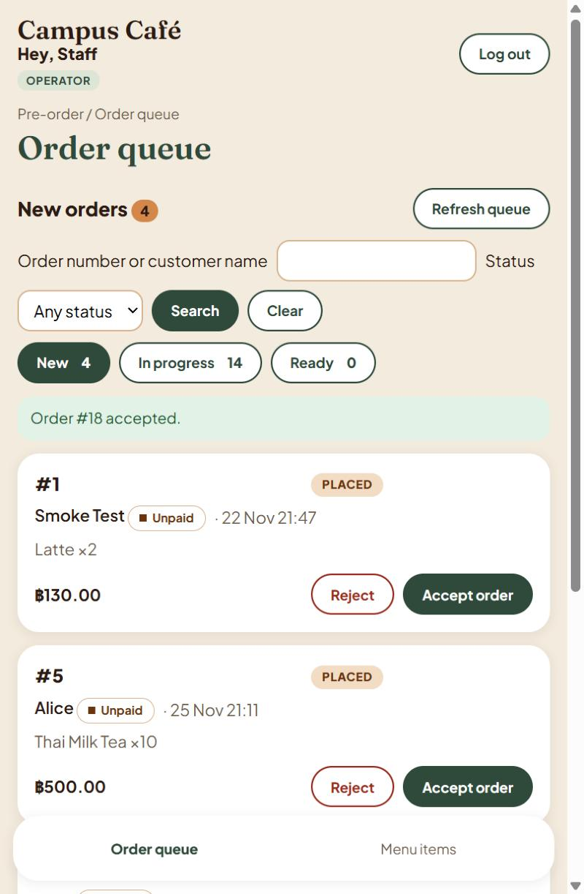
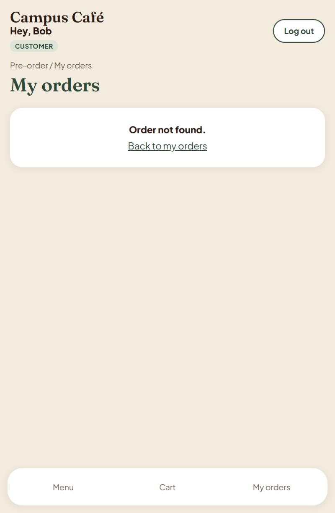

# Lab 7 — Maintenance change C-1: at most 15 items per order

CPE 334 · Semester 1/2026 · Section 131 · **Group EN-033_P4 (team Est)** · Theme 4 (Ordering system) · Campus Café Pre-order (Food-order).
Repository https://github.com/vienggd/Food-order · deployed https://food-order-d4jdyxqbca-as.a.run.app (Cloud Run revision `food-order-00011-9nh`) · accepted Sprint 1 baseline `v0.1.0-sprint1` / pre-change commit `b71cdb2` · release with the change `704a66b` · submitted `main` release tag `v0.3.0-rc1` = the report commit in the footer (docs-only release PR #232 on top of `704a66b`, same app bundle).
**Status 28 Nov 2026 08:45 (+07).** Parts A–D are filled. C-1 is released to `main` (`704a66b`), deployed (revision `food-order-00011-9nh`) and live checks L1–L8 all passed. What is still open is listed under Limitations.

## Contents

| Part | Title | Points | Where | Pages |
|---|---|---|---|---|
| A | Change impact and contract | 25 | Issue [#96](https://github.com/vienggd/Food-order/issues/96), `docs/labs/lab-07/impact.md`, PR [#103](https://github.com/vienggd/Food-order/pull/103) | 4; App. A1–A3 pp. 13–17 |
| B | Implementation and regression-safe delivery | 50 | PR [#112](https://github.com/vienggd/Food-order/pull/112), `evidence/red.txt`, `green.txt`, `regression.txt`; live checks L1–L8 PASS (`evidence/live-checks.md`) | 5–6; App. B1–B5 pp. 18–29 |
| C | Metrics | 15 | `docs/labs/lab-07/metrics.md` (snapshot 28 Nov 08:45, after the release) | 7; App. C1 p. 30 |
| D | Readiness and retrospective | 10 | summary table below; details in `docs/labs/lab-07/readiness.md`; live-check evidence in `evidence/live/` | 8–12; App. D1 pp. 31–34 |

## Team

| | |
|---|---|
| Students | **Garunyapas Danpitakkul** (vieng) — 67070503404 — GitHub [`vienggd`](https://github.com/vienggd)<br>**Dechayut Panyawutvorakul** (ninja) — 67070503414 — GitHub [`NinjoMUDA`](https://github.com/NinjoMUDA) |
| Repository | https://github.com/vienggd/Food-order |
| Board | https://github.com/users/vienggd/projects/4 |

## Version table

| Step | Version | Commit / id | Status |
|---|---|---|---|
| Sprint 1 baseline | tag `v0.1.0-sprint1` | tag on `main` | done |
| Version accepted in Lab 6 | Lab 6 release with the #132 fix: `main` merge of PR #181 | `39bda5e`, Cloud Run revision `food-order-00009-jd9` | done 26 Nov (Deploy demo run 45890211288, success) |
| Earlier Lab 6 release | Lab 6 release (PR #168) | `163fdb7`, revision `food-order-00008-v6c` | done 26 Nov (Deploy demo run 45860319259, success) |
| Actual pre-change commit | `main` after Lab 5 | `b71cdb2` | done |
| Contract | contract PR #103 merged into `lab7` | `9d976df` | done 25 Nov |
| Test commit (RED) | TEST-L7-1..5 + `red.txt` | `1b9e604` | done 25 Nov |
| Contract follow-up | 20 lines no longer reachable | `41031b7` | done 25 Nov |
| Fix commit | C-1 server check + cart | `7de5285` | done 25 Nov |
| Release to `main` | Lab 7 release PR #216 (`lab7` → `main`, merge commit) | `704a66b` | done 28 Nov 00:13 +07 (27 Nov 17:13:46 UTC) |
| Deployed revision | Cloud Run revision `food-order-00011-9nh`, bundle `assets/index-CDaqMZLn.js` | Deploy demo run `46040158850` | done, success (CI on the release PR: run `46039698561`, success) |
| Submitted release | Docs-only release PR #232 (`lab7` → `main`: live checks #229, appendices #230), approved and merged by ninja's side | tag `v0.3.0-rc1` = report commit (footer) | done 28 Nov, Deploy demo success, same bundle `index-CDaqMZLn.js` |
| Later-sprint changes | Sprint 2 was released to `main` first (`df6db99`, tag `v0.2.0-sprint2`, revision `food-order-00010-7vp`); `lab7` merged `main` in PR #211 and BR-01b was ported into the living docs (PR #211, #214) | `2bcf439` | done 27 Nov |

## Answer Part A: Change impact and contract

**Approved change.** Issue [#96](https://github.com/vienggd/Food-order/issues/96) (change request C-1). **TA Prapatsorn Sangrod approved it on 25 Nov 2026** (screenshots: `docs/labs/lab-07/evidence/ta-approval-1.png`, `ta-approval-2.png`). The four TA answers are recorded in #96 and in `impact.md` section 1.

| | Old rule | New rule |
|---|---|---|
| BR-01 | Quantity 1–10 on each order line | **Stays.** |
| BR-01b | (did not exist) | **New:** the sum of all line quantities in one order is at most 15. 14 and 15 are accepted (10 + 4, 10 + 5); 16 is refused (10 + 6, 8 + 8) |
| Error | — | 400 `VALIDATION_ERROR`, message "An order can have at most 15 items in total", `details { field: "lines", max: 15, total }` |
| Cart | + works up to 10 per line and 20 lines | warning at 15 and every + disabled, so a 16th item cannot be added |

**Impact (short).** Changed: SRS BR-01, F-03 contract, system SDS (rule table and flow step 3), traceability, `POST /api/orders`, the cart. Not changed (N/A with a reason each): database and migration (no new column), old orders (not re-checked), roles and access (401/403), operator queue, order editing (TA answer 4: not planned). Full table and what protects the unchanged parts: `docs/labs/lab-07/impact.md`.

**Contract diff (excerpt, PR [#103](https://github.com/vienggd/Food-order/pull/103), commit `c7f52fb`).**

```
+| BR-01b (Lab 7, C-1) | The sum of all `quantity` values in one order is at most 15 (10 + 5 ok, 10 + 6 rejected). Per-line 1-10 stays. | 400 VALIDATION_ERROR |
+| AC-L7-01 | When the quantities add up to 14 or 15 (e.g. 10 + 4, 10 + 5), then 201 PLACED. |
+| AC-L7-02 | When the quantities add up to 16 or more (10 + 6, 8 + 8), then 400 VALIDATION_ERROR, message "An order can have at most 15 items in total", details { field: "lines", max: 15, total }, and nothing is saved. |
+| AC-L7-03 | Per-line and per-order rules, roles (401/403) and old orders are unchanged. |
+| AC-L7-04 | In the cart, when the total reaches 15 a warning is shown and every + is disabled. |
+| TEST-L7-1 .. TEST-L7-5 | API (14 ok, 15 ok, 16 refused), unit (cart), E2E (warning and + disabled) |
```

**Review before code (timestamps, GitHub, UTC).** Reviewer: vieng (`vienggd`), author: ninja.

| Time | Event |
|---|---|
| 25 Nov 03:08:50 | PR #103 opened (contract only: docs, no test, no code) |
| 25 Nov 03:10:03 | vieng: **CHANGES_REQUESTED** |
| 25 Nov 03:10:20 | ninja replies: done in `beb05ae` (RED/GREEN plan added) |
| 25 Nov 03:11:35 | vieng: **APPROVED** |
| 25 Nov 03:11:40 | PR #103 merged into `lab7` |
| 25 Nov 03:15:14 | first test commit `1b9e604` (RED), 3 min 34 s **after** the contract merge |

vieng's review text (shortened): "Checked against the 4 TA answers and the Lab 7 rules. Answer 1: 15 = total of all items, 10+5 ok, 10+6 rejected, per-line 1-10 stays. Answer 2: 400 VALIDATION_ERROR, message and details as agreed. Answer 3: warning at 15 and + disabled. Answer 4: no order editing, N/A. [...] Needs change: the test plan does not say where the RED step runs; add a RED / GREEN plan and name where red.txt / green.txt are stored." After the fix: "Re-checked: section 5 RED/GREEN plan added."

## Answer Part B: Implementation and delivery

**Test set-up.** Real PostgreSQL (Vitest + Supertest, no mocks), Vitest for the cart, Playwright (phone and desktop) for the browser. Five new tests (TEST-L7-1..5):

| Test | Level | Input | Expected |
|---|---|---|---|
| TEST-L7-1 | API | Latte ×10 + Americano ×4 (14) | 201 |
| TEST-L7-2 | API | Latte ×10 + Americano ×5 (15) | 201 |
| TEST-L7-3 | API | (a) 10 + 6, (b) 8 + 8, also 10 + 10 (total 20) and 16 lines of 1; (c) one line of 11 | (a), (b): 400, the C-1 message, `details.total` = real sum, nothing saved; (c): 400 by the per-line rule |
| TEST-L7-4 | unit | cart at 14, then 15 | total never above 15, + refused at 15 |
| TEST-L7-5 | E2E | cart total 15 | warning visible, + disabled, Place order still works |

**RED (`1b9e604`, 25 Nov 10:15 +07).** Run on code identical to `main` `b71cdb2` (`git diff b71cdb2 --stat -- server/src client/src` = 0 lines). Excerpt of `evidence/red.txt`:

```
× TEST-L7-3 total 16 (10 + 6) is rejected ...   → expected 201 to be 400
× TEST-L7-3 total 16 (8 + 8) is rejected ...    → expected 201 to be 400
× TEST-L7-4 total never goes above 15 ...       → AssertionError: expected 19 to be 15
x TEST-L7-5 [phone] and [desktop]               → getByText(/at most 15 items in total/i) not found
```

They fail because the rule is missing, not because of a compile error. TEST-L7-1 and -2 (14 and 15 items) pass on old code by design: they protect the accepted range.

**Contract follow-up (`41031b7`).** With 15 items in total, 20 different lines can no longer be reached, so three old tests (TEST-F03-05, -18, -23) got reachable numbers. Agreed with vieng's side before the fix; no test deleted or weakened (impact.md section 3).

**GREEN (fix `7de5285`, 25 Nov 10:21 +07).** Server check (`server/src/orders/routes.ts`):

```ts
const MAX_ORDER_ITEMS = 15; // BR-01b
// ...
const total = items.reduce((n, i) => n + i.quantity, 0);
if (total > MAX_ORDER_ITEMS) {
  throw new AppError(400, "VALIDATION_ERROR", `An order can have at most ${MAX_ORDER_ITEMS} items in total`, {
    field: "lines", max: MAX_ORDER_ITEMS, total,
  });
}
```

Cart (`client/src/lib/cart.ts`): `MAX_ITEMS = 15`; `add` is refused at 15; `setQty` is capped by the other lines; `canAddFromMenu` and `atItemLimit` drive the disabled + and the warning in `MenuPage.tsx`. Excerpt of `evidence/green.txt`: server 37 passed (`orders.test.ts`), client 7 passed, TEST-L7-5 passed on phone and desktop.

**Regression (`evidence/regression.txt`).** Server **78**, client **7**, E2E **26** passed, 0 failed, 0 skipped (before the change: 71 and 6; orders, operator and auth suites: 58 passed). vieng ran `npm test` again on the PR head (78 and 7). Screenshots of the limit: `evidence/screenshots/L7-cart-limit-desktop.png`, `L7-cart-limit-phone.png`.

**PR review.** PR [#112](https://github.com/vienggd/Food-order/pull/112) (opened 25 Nov 03:21:20 UTC, merged 03:28:06 with a merge commit). vieng, APPROVED 03:28:02: "What I checked: commit order (RED 1b9e604, contract follow-up 41031b7, fix, then cleanup commits); red.txt shows only L7-3, L7-4, L7-5 failing on b71cdb2 code; I ran npm test on the latest head 93b2738: server 78 pass, client 7 pass. Fix returns 400 VALIDATION_ERROR with the agreed message and details; cart caps at 15, warns, disables +. Sprint 1 screenshots restored."

**Release, CI and live checks (done 28 Nov).**
- Release: PR #216 `lab7` → `main`, `main` `704a66b`, merged 28 Nov 00:13:46 +07. Before it, `lab7` merged the released Sprint 2 (PR #211, one conflict in `MenuPage.tsx`; I checked that the code diff against `main` is only C-1, build ok, server 184 and client 9 tests pass).
- CI on the release PR: `CI & Docker Build` run `46039698561`, success (npm test, build, Docker build; the first run `46039520267` was cancelled and re-run).
- Deployed revision: `food-order-00011-9nh`, Deploy demo run `46040158850`, success.
- Live checks on the deployed URL: all PASS, see Part D and `docs/labs/lab-07/evidence/live-checks.md`. Screenshots: `evidence/live/L2-order-18-placed.png`, `L4-cart-15-warning.png`, `L6-old-order-13.png`, `L7-staff-18-accepted.jpg`, `L8-bob-alice-order-404.jpg`.

## Answer Part C: Metrics

Snapshot **28 Nov 2026 08:45 (+07)**, after the release; window 24–29 Nov, data from `gh`. Full definitions, scope and source lists: `docs/labs/lab-07/metrics.md`.

| # | Metric | Value |
|---|---|---|
| M1 | Completed Issues | **63** (64 closed; #127 NOT_PLANNED) = 98 % |
| M2 | Merged PRs | **66** = 25 into `sprint2`, 22 into `lab6`, 13 into `lab7`, 6 into `main` |
| M3 | Tests | C-1 alone (`3c276b2`): server **78** / client **7** / E2E **26**, 0 failed, 0 skipped. With Sprint 2 merged (PR #211): server **184** / client **9** |
| M4 | UAT defect status | **9 of 9 accepted Lab 6 defects fixed, re-tested PASS and closed**; of the 3 deferred enhancements #130 is closed, #131 and #133 are still open |
| M5 | CI and deploy runs | **15 runs: 14 success, 0 failure, 1 cancelled (re-run, success)**; release PR #216 CI success; Deploy demo for `704a66b` success |

Interpretation: C-1 is released and verified: the release PR ran CI once (green), the deploy was green, live checks L1–L8 passed on `food-order-00011-9nh`, and no run failed in the window. Remaining risk: E2E is not part of CI, so the 26 E2E tests rest on local runs; #131 and #133 are open for Sprint 3. Action: add the E2E job to CI and schedule #131 and #133; owner vieng (CI), ninja (#131, #133).

## Answer Part D: Readiness and retrospective

Full checklist, rollback, defects, technical debt, verdict and retrospective: `docs/labs/lab-07/readiness.md` (vieng). Summary as of **28 Nov 2026 08:45 (+07)**, after the release and the live checks.

**Release checklist (readiness.md section 1)**

| # | Check | Status |
|---|---|---|
| 1 | Baseline green before the change (server 71, client 6) | done |
| 2 | Contract merged before any test or code (PR #103) | done |
| 3 | RED commit `1b9e604` before the fix `7de5285` | done |
| 4 | GREEN after the fix (`evidence/green.txt`) | done |
| 5 | Full regression: server 78, client 7, no test weakened | done |
| 6 | E2E: 26 passed, 0 failed, 0 skipped | done |
| 7 | CI | done: CI does not run on the staging PRs into `lab7`; on the release PR #216 run `46039698561` = success |
| 8 | Docs match (SRS, F-03 contract, SDS, traceability) | done |
| 9 | Migration | none needed (no schema change) |
| 10 | Old data: old orders still open normally | done |
| 11 | No secrets in the change | done |
| 12 | Every Lab 7 PR approved by the other side, merge commit | done |

**Rollback.** Code only, no migration, no data change. Run the `deploy` workflow manually with the full commit SHA of the previous good image (now the Sprint 2 release `df6db99`, revision `food-order-00010-7vp`), then check `/api/health`, `/api/ready` and the smoke test.

**Live checks after the deploy (readiness.md section 4; revision `food-order-00011-9nh`, 28 Nov 2026, +07; details in `evidence/live-checks.md`)**

| # | Check | Result | Time | Evidence |
|---|---|---|---|---|
| L1 | `/api/health` and `/api/ready` | PASS: ok; `{"status":"ready","db":"connected"}` | 28 Nov | response text |
| L2 | 15 items in total (Latte ×10 + Americano ×5) | PASS: 201, order #18 PLACED, total 92500 satang | 01:19:43 | `live/L2-order-18-placed.png`, `live/L2-L6-my-orders-list.png` |
| L3 | 16 items (10 + 6) | PASS: 400 `VALIDATION_ERROR`, "An order can have at most 15 items in total", details `{field:"lines",max:15,total:16}`; alice's orders 16 before and after | 00:52:18 | API response |
| L4 | Cart warns at 15 and disables every + | PASS: warning shown; all 6 Add buttons and cart + disabled | 01:19:39 | `live/L4-cart-15-menu.png`, `live/L4-cart-15-warning.png` |
| L5 | One line of 11 | PASS: 400 (`items.0.quantity`, max 10) | 00:52:18 | API response |
| L6 | Old order #13 (26 Nov) still lists and opens | PASS | 01:20:08 | `live/L6-old-order-13.png` |
| L7 | Staff accepts the 15-item order #18 | PASS: PLACED → ACCEPTED (`acceptedAt` 2026-11-28T01:39:21.738Z), toast "Order #18 accepted." | 08:39:21 | `live/L7-staff-queue-18-placed.jpg`, `live/L7-staff-accept-18-toast.jpg`, `live/L7-staff-18-accepted.jpg` |
| L8 | Access path | PASS: anonymous 401; alice on the staff queue 403 `FORBIDDEN` (00:52:08); bob on alice's order 404 `NOT_FOUND` (08:34:45) | see left | `live/L8-bob-alice-order-404.jpg` |

**Defects.** C-1: 0 defects found, also none in the live checks. Sprint 1 UAT findings: 9 of 9 accepted defects fixed, re-tested PASS and closed; 3 enhancements (#130, #131, #133) deferred to Sprint 3, of which #131 and #133 are still open (see Part C).

**Technical debt (readiness.md section 6).** The 15 limit is written twice (server and client), medium; CI does not start on staging-branch PRs, medium; BR-01b is now in the living docs (PR #211, #214), done; E2E screenshots overwrite the Sprint 1 PNGs, low.

**Verdict: READY and released** for the maintained scope (C-1 plus preserved Sprint 1 behaviour): release `704a66b` is deployed as `food-order-00011-9nh`, CI and Deploy demo are green, live checks L1–L8 PASS. Nothing is open for the maintained scope (the TA allowed newer deploys on the Lab 5 URL on 25 Nov); Sprint 3 items are listed under Limitations. Rollback target if ever needed: `df6db99` / `food-order-00010-7vp`.

**Retrospective (short).** Helped: reviewing the impact table and contract before any code caught the unreachable 20-line tests early. Hurt: a local E2E run overwrote the Sprint 1 screenshots (cleanup `8f6110f`), and CI does not start on staging branch PRs. Change for the final release: parameterize the screenshot folder and check `git status` for stray PNGs before every push.

## Contribution

| Work | Owner | Reviewer |
|---|---|---|
| Change request, impact, C-1 contract (PR #103), RED → fix → GREEN (PR #112), metrics, report Parts A–C, live checks L2–L8 (signed in by hand) | ninja | vieng (requested changes on #103 before any code; ran the tests on #112 before approving) |
| TA approval request and evidence (PR #108), readiness checklist (PR #109, #114), merge of released `main` into `lab7` with conflict resolution (PR #211), release PR #216, live checks L1 + L8 (anonymous), report appendices and final PDF | vieng | ninja |

## AI use

Both students used AI assistants (Claude Code sessions, plus Antigravity on vieng's side) for drafts of the impact table, tests, code, live-check clicking and this report. Every PR was reviewed and merged by the other student's side; the TA approval and decisions are the students'.

## Limitations

- Open items: #131 and #133 (accessibility enhancements, scheduled in Sprint 3 with an open PR).
- CI did not run on the staging PRs into `lab7`, so their test evidence is from local runs; CI ran once on the release PR. E2E is not part of CI.
- Live-check results for L1, L3, L5 are API responses without a screenshot; the others have screenshots in `evidence/live/`.
- The 15-item cap makes the old 20-line limit unreachable (kept in the schema).

## Appendices

These appendices put the assessed material directly in this PDF (handout §4.1).

### Appendix A1 — TA approval of change C-1 (25 Nov 2026)





### Appendix A2 — Impact analysis

<!-- INCLUDE: impact.md -->

### Appendix A3 — Revised contract sections for C-1 (SRS/SDS/AC/STS)

<!-- INCLUDE: contract-C-1.md -->

### Appendix B1 — RED output on the pre-change code

```text
RED run, 25 Nov 2026. Production code = pre-change behaviour of main b71cdb2.
Check: git diff b71cdb2 --stat -- server/src client/src ':!*.test.ts'  =>  0 lines (0 = production code identical to b71cdb2)
Node v24.14.0, vitest vitest/3.2.7 win32-x64 node-v24.14.0, playwright Version 1.64.1

== server: cd server && npx vitest run tests/orders.test.ts ==
   ✓ Lab 7 C-1 BR-01b at most 15 items in total > TEST-L7-1 total 14 (10 + 4) is accepted  310ms
   ✓ Lab 7 C-1 BR-01b at most 15 items in total > TEST-L7-2 total 15 (10 + 5) is accepted 259ms
   × Lab 7 C-1 BR-01b at most 15 items in total > TEST-L7-3 total 16 (10 + 6) is rejected with the C-1 message and details, nothing saved 256ms
     → expected 201 to be 400 // Object.is equality
   × Lab 7 C-1 BR-01b at most 15 items in total > TEST-L7-3 total 16 (8 + 8) is rejected with the C-1 message and details, nothing saved 260ms
     → expected 201 to be 400 // Object.is equality
   ✓ Lab 7 C-1 BR-01b at most 15 items in total > TEST-L7-3 a single line of 11 is still rejected by the per-line rule, nothing saved 262ms
⎯⎯⎯⎯⎯⎯⎯ Failed Tests 2 ⎯⎯⎯⎯⎯⎯⎯
 FAIL  tests/orders.test.ts > Lab 7 C-1 BR-01b at most 15 items in total > TEST-L7-3 total 16 (10 + 6) is rejected with the C-1 message and details, nothing saved
 FAIL  tests/orders.test.ts > Lab 7 C-1 BR-01b at most 15 items in total > TEST-L7-3 total 16 (8 + 8) is rejected with the C-1 message and details, nothing saved
    235|   ])("TEST-L7-3 total 16 (%s) is rejected with the C-1 message and det…
 Test Files  1 failed (1)
      Tests  2 failed | 33 passed (35)

== client: cd client && npx vitest run ==
   × Lab 7 C-1 cart limit of 15 items in total > TEST-L7-4 total never goes above 15; + is refused at 15; every + on the menu is disabled only at 15 5ms
⎯⎯⎯⎯⎯⎯⎯ Failed Tests 1 ⎯⎯⎯⎯⎯⎯⎯
 FAIL  src/lib/cart.test.ts > Lab 7 C-1 cart limit of 15 items in total > TEST-L7-4 total never goes above 15; + is refused at 15; every + on the menu is disabled only at 15
AssertionError: expected 19 to be 15 // Object.is equality
 Test Files  1 failed | 2 passed (3)
      Tests  1 failed | 6 passed (7)

== e2e: npx playwright test e2e/orders.spec.ts -g TEST-L7-5 ==
  x  1 [phone] › e2e\orders.spec.ts:20:7 › F-03 place order › TEST-L7-5 at 15 items the cart shows a warning and + is disabled; the order is still placed (5.9s)
  x  2 [desktop] › e2e\orders.spec.ts:20:7 › F-03 place order › TEST-L7-5 at 15 items the cart shows a warning and + is disabled; the order is still placed (5.8s)
  1) [phone] › e2e\orders.spec.ts:20:7 › F-03 place order › TEST-L7-5 at 15 items the cart shows a warning and + is disabled; the order is still placed 
    Error: expect(locator).toBeVisible() failed
    Error: element(s) not found
      - Expect "toBeVisible" getByRole('region', { name: 'Cart' }).getByText(/at most 15 items in total/i) with timeout 5000ms
    > 29 |     await expect(cart.getByText(/at most 15 items in total/i)).toBeVisible();
  2) [desktop] › e2e\orders.spec.ts:20:7 › F-03 place order › TEST-L7-5 at 15 items the cart shows a warning and + is disabled; the order is still placed 
    Error: expect(locator).toBeVisible() failed
    Error: element(s) not found
      - Expect "toBeVisible" getByRole('region', { name: 'Cart' }).getByText(/at most 15 items in total/i) with timeout 5000ms
    > 29 |     await expect(cart.getByText(/at most 15 items in total/i)).toBeVisible();
```

### Appendix B2 — GREEN output and Sprint 1 regression

```text
GREEN run, 25 Nov 2026, after the fix (fix commit follows the RED commit 1b9e604 and the contract follow-up 41031b7). Node v24.14.0, vitest 3.2.7, playwright Version 1.64.1

== server: cd server && npx vitest run tests/orders.test.ts ==
   ✓ F-03 POST /api/orders > TEST-F03-05 BR-02 boundary: 15 different lines are accepted (20 lines need 20 items, above the C-1 limit)  322ms
   ✓ Lab 7 C-1 BR-01b at most 15 items in total > TEST-L7-2 total 15 (10 + 5) is accepted  304ms
   ✓ Lab 7 C-1 BR-01b at most 15 items in total > TEST-L7-3 details.total is the real sum: 10 + 10 gives total 20  304ms
   ✓ Lab 7 C-1 BR-01b at most 15 items in total > TEST-L7-3 16 lines of 1 are rejected (total 16), nothing saved  316ms
 Test Files  1 passed (1)
      Tests  37 passed (37)

== client: cd client && npx vitest run ==
 Test Files  3 passed (3)
      Tests  7 passed (7)

== e2e: npx playwright test e2e/orders.spec.ts -g TEST-L7-5 ==
  ok 1 [phone] › e2e\orders.spec.ts:20:7 › F-03 place order › TEST-L7-5 at 15 items the cart shows a warning and + is disabled; the order is still placed (1.0s)
  ok 2 [desktop] › e2e\orders.spec.ts:20:7 › F-03 place order › TEST-L7-5 at 15 items the cart shows a warning and + is disabled; the order is still placed (804ms)
  2 passed (11.2s)
```

```text
Regression run, 25 Nov 2026, on the fix commit. Same suites as Sprint 1 plus the new tests. No existing test deleted or weakened; 3 old tests got reachable numbers (impact.md section 3).
Baseline before the change (b71cdb2 code, vieng and ninja runs): server 8 files / 71 tests pass, client 3 files / 6 tests pass.

== selected suites (orders, operator, auth): cd server && npx vitest run tests/orders.test.ts tests/operator.test.ts tests/auth.test.ts ==
 Test Files  3 passed (3)
      Tests  58 passed (58)

== all unit/API tests: npm test ==
 Test Files  8 passed (8)
      Tests  78 passed (78)
 Test Files  3 passed (3)
      Tests  7 passed (7)

== all E2E: npx playwright test ==
  26 passed (28.3s)
```

### Appendix B3 — Code diff of the change (PR #112)

```text
Code change for C-1 (PR #112, source files only; tests are in Appendix B1/B2)

diff --git a/client/src/lib/cart.test.ts b/client/src/lib/cart.test.ts
index a958aa2..826ede0 100644
--- a/client/src/lib/cart.test.ts
+++ b/client/src/lib/cart.test.ts
@@ -1,5 +1,5 @@
 import { describe, it, expect } from "vitest";
-import { canAddFromMenu, cartReducer, emptyCart, MAX_LINES, type Cart } from "./cart";
+import { canAddFromMenu, cartReducer, emptyCart, MAX_ITEMS, MAX_LINES, type Cart } from "./cart";
 
 const item = (id: number, price = 1000) => ({ id, name: `Item ${id}`, price });
 const apply = (cart: Cart, ...actions: Parameters<typeof cartReducer>[1][]) => actions.reduce(cartReducer, cart);
@@ -20,9 +20,8 @@ describe("cartReducer", () => {
     cart = apply(cart, { type: "setQty", menuItemId: 1, quantity: 10 }, { type: "add", item: item(1) });
     expect(cart.lines[0].quantity).toBe(10); // + at 10 does nothing
 
-    let full = emptyCart;
-    for (let i = 1; i <= MAX_LINES; i++) full = apply(full, { type: "add", item: item(i) });
-    expect(full.lines).toHaveLength(20);
+    // 20 lines built directly: the reducer itself stops at 15 items (C-1)
+    const full: Cart = { lines: Array.from({ length: MAX_LINES }, (_, i) => ({ menuItemId: i + 1, name: `Item ${i + 1}`, price: 1000, quantity: 1 })) };
     expect(apply(full, { type: "add", item: item(21) }).lines).toHaveLength(20);
   });
 
@@ -33,11 +32,30 @@ describe("cartReducer", () => {
     expect(apply(cart, { type: "clear" }).lines).toEqual([]);
   });
 
-  it("TEST-F03-23 at 20 lines every menu + is disabled", () => {
+  it("TEST-F03-23 at 15 items every menu + is disabled (was 20 lines; 20 lines are no longer reachable)", () => {
     let cart = emptyCart;
-    for (let i = 1; i < MAX_LINES; i++) cart = apply(cart, { type: "add", item: item(i) });
-    expect(canAddFromMenu(cart)).toBe(true);
-    cart = apply(cart, { type: "add", item: item(MAX_LINES) });
+    for (let i = 1; i < MAX_ITEMS; i++) cart = apply(cart, { type: "add", item: item(i) });
+    expect(canAddFromMenu(cart)).toBe(true); // 14 lines of 1
+    cart = apply(cart, { type: "add", item: item(MAX_ITEMS) });
+    expect(canAddFromMenu(cart)).toBe(false); // 15
+    const twenty: Cart = { lines: Array.from({ length: MAX_LINES }, (_, i) => ({ menuItemId: i + 1, name: "x", price: 1, quantity: 1 })) };
+    expect(canAddFromMenu(twenty)).toBe(false);
+  });
+});
+
+// Lab 7, change C-1: at most 15 items in total.
+describe("Lab 7 C-1 cart limit of 15 items in total", () => {
+  const itemCount = (c: Cart) => c.lines.reduce((n, l) => n + l.quantity, 0);
+  it("TEST-L7-4 total never goes above 15; + is refused at 15; every + on the menu is disabled only at 15", () => {
+    let cart = apply(emptyCart, { type: "add", item: item(1) }, { type: "add", item: item(2) });
+    cart = apply(cart, { type: "setQty", menuItemId: 1, quantity: 10 }, { type: "setQty", menuItemId: 2, quantity: 4 });
+    expect(itemCount(cart)).toBe(14);
+    expect(itemCount(apply(cart, { type: "add", item: item(2) }))).toBe(15); // the 15th is allowed
+    cart = apply(cart, { type: "setQty", menuItemId: 2, quantity: 9 }); // asks for 19 in total
+    expect(itemCount(cart)).toBe(15); // capped
+    expect(itemCount(apply(cart, { type: "add", item: item(2) }))).toBe(15); // + at 15 does nothing
+    expect(itemCount(apply(cart, { type: "add", item: item(3) }))).toBe(15); // a new item is refused too
     expect(canAddFromMenu(cart)).toBe(false);
+    expect(canAddFromMenu(apply(cart, { type: "setQty", menuItemId: 2, quantity: 4 }))).toBe(true); // 14
   });
 });
diff --git a/client/src/lib/cart.ts b/client/src/lib/cart.ts
index 8c54c31..79efb06 100644
--- a/client/src/lib/cart.ts
+++ b/client/src/lib/cart.ts
@@ -1,10 +1,12 @@
 // Client cart (F-03). Only for convenience: the server re-checks every rule (BR-01..BR-04).
 export const MAX_QTY = 10; // BR-01
 export const MAX_LINES = 20; // BR-02
+export const MAX_ITEMS = 15; // BR-01b (Lab 7, C-1): items in total over all lines
 
 export type CartLine = { menuItemId: number; name: string; price: number; quantity: number };
 export type Cart = { lines: CartLine[] };
 export const emptyCart: Cart = { lines: [] };
+export const itemCount = (cart: Cart) => cart.lines.reduce((n, l) => n + l.quantity, 0);
 
 type Item = { id: number; name: string; price: number };
 export type CartAction =
@@ -20,14 +22,16 @@ export function cartReducer(cart: Cart, action: CartAction): Cart {
     case "add": {
       const line = cart.lines.find((l) => l.menuItemId === action.item.id);
       if (line) return cartReducer(cart, { type: "setQty", menuItemId: line.menuItemId, quantity: line.quantity + 1 });
-      if (cart.lines.length >= MAX_LINES) return cart;
+      if (cart.lines.length >= MAX_LINES || itemCount(cart) >= MAX_ITEMS) return cart;
       const { id, name, price } = action.item;
       return { lines: [...cart.lines, { menuItemId: id, name, price, quantity: 1 }] };
     }
-    case "setQty":
-      return {
-        lines: cart.lines.map((l) => (l.menuItemId === action.menuItemId ? { ...l, quantity: clampQty(action.quantity) } : l)),
-      };
+    case "setQty": {
+      // the other lines keep their quantity; this line may only use what is left of the 15 (never below 1)
+      const others = itemCount(cart) - (cart.lines.find((l) => l.menuItemId === action.menuItemId)?.quantity ?? 0);
+      const q = Math.max(1, Math.min(clampQty(action.quantity), MAX_ITEMS - others));
+      return { lines: cart.lines.map((l) => (l.menuItemId === action.menuItemId ? { ...l, quantity: q } : l)) };
+    }
     case "remove":
       return { lines: cart.lines.filter((l) => l.menuItemId !== action.menuItemId) };
     case "clear":
@@ -38,4 +42,5 @@ export function cartReducer(cart: Cart, action: CartAction): Cart {
 export const estimatedTotal = (cart: Cart) => cart.lines.reduce((sum, l) => sum + l.price * l.quantity, 0);
 
 // ui-spec S2: at 20 lines every + on the menu is disabled (lines in the cart change only with their stepper).
-export const canAddFromMenu = (cart: Cart) => cart.lines.length < MAX_LINES;
+export const canAddFromMenu = (cart: Cart) => cart.lines.length < MAX_LINES && itemCount(cart) < MAX_ITEMS;
+export const atItemLimit = (cart: Cart) => itemCount(cart) >= MAX_ITEMS;
diff --git a/client/src/pages/MenuPage.tsx b/client/src/pages/MenuPage.tsx
index 3695e2e..c4ac29c 100644
--- a/client/src/pages/MenuPage.tsx
+++ b/client/src/pages/MenuPage.tsx
@@ -2,7 +2,7 @@ import { useCallback, useEffect, useState } from "react";
 import { useLocation, useNavigate } from "react-router-dom";
 import { api, ApiError, NETWORK_MESSAGE } from "../api";
 import { useCart } from "../cart";
-import { canAddFromMenu, estimatedTotal, MAX_QTY } from "../lib/cart";
+import { atItemLimit, canAddFromMenu, estimatedTotal, MAX_ITEMS, MAX_QTY } from "../lib/cart";
 import { formatBaht } from "../lib/money";
 import type { Order } from "../lib/orders";
 
@@ -99,7 +99,8 @@ export function MenuPage() {
   const count = cart.lines.reduce((n, l) => n + l.quantity, 0);
   const total = estimatedTotal(cart);
   const full = !canAddFromMenu(cart);
-  const fullMsg = "Cart is full (20 different items max).";
+  const atLimit = atItemLimit(cart);
+  const fullMsg = atLimit ? "" : "Cart is full (20 different items max).";
 
   async function placeOrder() {
     setSubmitting(true);
@@ -185,7 +186,7 @@ export function MenuPage() {
                   <button
                     aria-label={`More ${l.name}`}
                     title={l.quantity >= MAX_QTY ? "Max 10 per item." : undefined}
-                    disabled={submitting || l.quantity >= MAX_QTY}
+                    disabled={submitting || l.quantity >= MAX_QTY || atLimit}
                     onClick={() => dispatch({ type: "setQty", menuItemId: l.menuItemId, quantity: l.quantity + 1 })}
                   >
                     +
@@ -210,7 +211,12 @@ export function MenuPage() {
           ))}
         </ul>
       )}
-      {full && <div className="msg info">{fullMsg}</div>}
+      {atLimit && (
+        <div className="msg info" role="status">
+          Limit reached: an order can have at most {MAX_ITEMS} items in total.
+        </div>
+      )}
+      {full && !atLimit && <div className="msg info">{fullMsg}</div>}
       <p className="muted">Pickup: ASAP</p>
       <div className="cart-total">
         <span>Estimated total</span>
@@ -236,7 +242,7 @@ export function MenuPage() {
             <p className="muted">{load.items.length} items · sold-out items can't be added</p>
           </div>
         )}
-        {full && <p className="hint">{fullMsg}</p>}
+        {full && !atLimit && <p className="hint">{fullMsg}</p>}
         <MenuList
           load={load}
           reload={reload}
diff --git a/server/src/orders/routes.ts b/server/src/orders/routes.ts
index 07255f4..a75572e 100644
--- a/server/src/orders/routes.ts
+++ b/server/src/orders/routes.ts
@@ -9,6 +9,8 @@ import { dbId, MAX_DB_ID } from "../ids.js";
 export const ordersRouter = Router();
 ordersRouter.use(requireRole("CUSTOMER"));
 
+const MAX_ORDER_ITEMS = 15; // BR-01b
+
 // Strict: any extra key (price, unitPrice, total, customerId...) is a 400 (BR-04).
 const placeBody = z.strictObject({
   items: z
@@ -27,6 +29,16 @@ type BadItem = { menuItemId: number; reason: "DUPLICATE" | "NOT_FOUND" | "SOLD_O
 ordersRouter.post("/", async (req, res) => {
   const { items } = placeBody.parse(req.body);
 
+  // BR-01b (Lab 7, C-1): at most 15 items in total over all lines.
+  const total = items.reduce((n, i) => n + i.quantity, 0);
+  if (total > MAX_ORDER_ITEMS) {
+    throw new AppError(400, "VALIDATION_ERROR", `An order can have at most ${MAX_ORDER_ITEMS} items in total`, {
+      field: "lines",
+      max: MAX_ORDER_ITEMS,
+      total,
+    });
+  }
+
   const seen = new Set<number>();
   const duplicates: BadItem[] = [];
   for (const { menuItemId } of items) {
```

### Appendix B4 — Issue/PR review text, CI and deploy results

```text
Issue/PR review text and CI/deploy results for C-1 (from GitHub via gh)

PR #103 L7-1: contract for C-1 - order has at most 15 items in total
  author NinjoMUDA -> lab7; merged by vienggd at 2026-11-25T03:11:40Z as 9d976df
  checks: 
  review by vienggd (CHANGES_REQUESTED) 2026-11-25T03:10:03Z:
    Checked against the 4 TA answers and the Lab 7 rules. Almost everything is right; one thing is missing.
    
    OK:
    - Answer 1: 15 = total of all items, 10+5 ok, 10+6 rejected, per-line 1-10 stays (impact.md, F-03 BR-01b, AC-L7-01/02).
    - Answer 2: 400 VALIDATION_ERROR, message "An order can have at most 15 items in total", details {field:"lines", max:15, total} (error table, AC-L7-02, TEST-L7-3).
    - Answer 3: warning at 15 and + disabled (AC-L7-04, TEST-L7-4/5).
    - Answer 4: no order editing, N/A (impact table).
    - SRS BR-01 text updated, system-sds rule table and flow step 3 updated, traceability row updated (still "Pending").
    - ACs and tests cover 15 ok (TEST-L7-2), 14 ok (-1), 10+6 and 8+8 rejected (-3a/b), per-line 11 still rejected (-3c).
    
    Needs change:
    1. The test plan does not say where the RED step runs. Please add a short "RED / GREEN plan" in impact.md (or the F-03 test spec): TEST-L7-1..5 are committed first and run on the baseline code b71cdb2 behaviour (before the fix); TEST-L7-2/3/4/5 must FAIL there (red.txt), -1 passes on the old code; then the fix commit; then GREEN (green.txt) plus full regression. Also name where red.txt / green.txt are stored (e.g. docs/labs/lab-07/evidence/).
    
    Small, not blocking: TEST-L7-1..5 rows sit between TEST-F03-24 and -19; fine, just keep the order in the later test file.
  review by vienggd (APPROVED) 2026-11-25T03:11:35Z:
    Re-checked: section 5 RED/GREEN plan added. What I checked: 4 TA answers, BR-01/BR-01b text, AC-L7-01..04, TEST-L7-1..5, SDS and traceability.

PR #112 L7-1: C-1 at most 15 items in total (RED, fix, GREEN)
  author NinjoMUDA -> lab7; merged by vienggd at 2026-11-25T03:28:06Z as 43a9a68
  checks: 
  review by vienggd (APPROVED) 2026-11-25T03:28:02Z:
    What I checked: commit order (RED 1b9e604, contract follow-up 41031b7, fix, then cleanup commits); red.txt shows only L7-3, L7-4, L7-5 failing on b71cdb2 code; I ran npm test on the latest head 93b2738: server 78 pass, client 7 pass. Fix returns 400 VALIDATION_ERROR with the agreed message and details; cart caps at 15, warns, disables +. Sprint 1 screenshots restored.

PR #211 L7-6: merge released main into lab7 before release
  author vienggd -> lab7; merged by NinjoMUDA at 2026-11-27T17:04:56Z as cf6bde2
  checks: 
  review by NinjoMUDA (APPROVED) 2026-11-27T17:04:52Z:
    What I checked (head 2bcf439, I ran it locally):
    - Code diff of the PR head against main df6db99 is only C-1: server/src/orders/routes.ts (15-item check, 400 with message and details), client cart.ts and MenuPage.tsx, plus TEST-L7 tests. No Sprint 2 file changed, so nothing from Sprint 2 was lost in the conflict.
    - MenuPage.tsx: the 'Limit reached ... 15 items' warning, atLimit (+ disabled) and the Sprint 2 SlotPicker are all there.
    - npm run build ok. npm test: server 15 files / 184 tests pass, client 4 files / 9 tests pass (real Postgres).
    - Living docs: BR-01 C-1 text in docs/srs.md, docs/features.md, docs/traceability.md.
    - CI: no checks on this PR (CI starts on PRs into main).
    Not blocking: docs/system-sds.md (living) does not mention C-1 yet (it still says quantity 1-10 at the schema line and the rules table). I will port it in a small follow-up PR.

PR #214 L7-6: port C-1 into living docs/system-sds.md
  author NinjoMUDA -> lab7; merged by vienggd at 2026-11-27T17:08:53Z as f81cb5a
  checks: 
  review by vienggd (APPROVED) 2026-11-27T17:08:49Z:
    What I checked (vieng's head): system-sds.md now states the C-1 15-item total in the rule table, the place-order flow step 3, and the order_lines quantity row (no DB constraint, no migration) — matches the code in orders/routes.ts and the living SRS/traceability from #211.

PR #216 Release: Lab 7 change C-1 (max 15 items per order)
  author vienggd -> main; merged by NinjoMUDA at 2026-11-27T17:13:46Z as 704a66b
  checks: test-and-docker=SUCCESS
  review by NinjoMUDA (CHANGES_REQUESTED) 2026-11-27T17:09:40Z:
    One fix before release; the rest looks good.
    
    Checked: main fully contained in lab7 (0 missing commits); code diff is only C-1 (orders/routes.ts check, MenuPage warning, orders.test.ts, e2e/orders.spec.ts); Lab 7 docs, evidence and PDF script added; no secrets in added lines.
    
    Blocking: the PR edits the frozen Deliverable 1 copies, docs/sprint_1/srs.md, system-sds.md, traceability.md and sprints/sprint-1/F-03-orders.md. Their banner says 'Frozen as submitted for Deliverable 1. Do not edit.' C-1 is already in the living docs (docs/srs.md, system-sds.md, traceability.md, features.md, via #211/#214). As agreed earlier, spec edits go to the living docs at merge, so please restore the frozen copies to main's version:
    git checkout origin/main -- docs/sprint_1/srs.md docs/sprint_1/system-sds.md docs/sprint_1/traceability.md docs/sprint_1/sprints/sprint-1/F-03-orders.md
    If the Lab 7 report links to those files for the spec change, point the links to the living docs instead (docs/srs.md etc.).
  review by NinjoMUDA (APPROVED) 2026-11-27T17:13:42Z:
    What I checked (re-review on 2f080a8):
    - The 4 frozen Sprint 1 copies now have 0 diff against main, so my change request is fixed.
    - The C-1 contract rows are kept in docs/labs/lab-07/contract-C-1.md, and impact.md section 6 points to where the rule lives now.
    - main is fully contained in lab7. The code diff is only C-1: server check, MenuPage warning, API/unit/e2e tests.
    - No secrets in added lines.
    - CI test-and-docker: pass.
    Approved for the Lab 7 release.

PR #229 L7-7: Lab 7 live checks L1-L8 PASS, release facts, final metrics (28 Nov)
  author NinjoMUDA -> lab7; merged by vienggd at 2026-11-28T07:36:30Z as f5bb6a4
  checks: 
  review by vienggd (APPROVED) 2026-11-28T07:36:26Z:
    What I checked (vieng's head): live-checks.md L1-L8 match the head-chat reports and the screenshots (#18 placed 15 items ฿925.00, 16 rejected 400 with C-1 message/details, cart warning + disabled +, line of 11 -> 400, old #13 unchanged, staff accept #18, bob 404, alice 403, anonymous 401). Read all 9 screenshots at full size: app screens only, demo accounts, no passwords or URL bars. readiness/report/metrics agree with 704a66b / food-order-00011-9nh / run 46040158850; Group EN-033_P4 on page 1.

Deploy demo run 46040158850 (704a66b): success -> Cloud Run food-order-00011-9nh, bundle assets/index-CDaqMZLn.js, /api/ready ready + db connected
```

### Appendix B5 — Post-deployment checks L1–L8

<!-- INCLUDE: evidence/live-checks.md -->













### Appendix C1 — Metric definitions and sources

<!-- INCLUDE: metrics.md -->

### Appendix D1 — Readiness checklist

<!-- INCLUDE: readiness.md -->
