# Deliverable 2, Part B: Working Sprint 2 prototype and demonstration

Campus Café Pre-order — Team **Est** (`vienggd/Food-order`). Author: **vieng** (`vienggd`), Issue **#192**.
Tested on staging integration branch `sprint2` (synced with `main` `39bda5e` via `PR #191`). Every screenshot in section B.3 is an unedited full-quality `@2x` Chromium capture (`deviceScaleFactor: 2`) against live Vite + Express + PostgreSQL 16 (`cafe_e2e`).

## B.1 Setup and local verification steps

```bash
npm install
cp server/.env.example server/.env          # set SEED_PASSWORD locally (never committed)
docker compose up -d                        # PostgreSQL 16 on localhost:5433
npm run db:migrate && npm run db:seed       # applies all 4 migrations + 3 seeded accounts + 6 menu items
npm run build                               # prisma generate + server tsc + client tsc + vite build
npm test                                    # server Vitest (real Postgres) + client Vitest
npx playwright test                         # Playwright phone (375px) + desktop (1280px)
```

Seeded accounts (synthetic local test data): `alice@cafe.test` and `bob@cafe.test` (`CUSTOMER`), `staff@cafe.test` (`OPERATOR`). Passwords come exclusively from `SEED_PASSWORD` in `server/.env`.

## B.2 Sprint 1 continuity + Sprint 2/3 feature demonstrations

### Scenario 1 — Sprint 1 menu continuity + F-09 pickup slot order (`F-02`, `F-03`, `F-09`)

| | |
|---|---|
| Scope / AC | Sprint 1 continuity (`F-02`, `F-03`: price copy `BR-05`, server total `BR-04`, sold-out Croissant disabled `BR-03`) + Sprint 3 (`F-09` `FR-16`, `BR-22`, `AC-F09-01`) |
| Role / Start | `CUSTOMER` (`alice@cafe.test`) on `/menu` after seeded reset |
| Steps | Add Latte ×2 and Thai Milk Tea ×1 -> open Cart -> verify pickup time selector (`ASAP` default + today's 08:00–16:45 slots) -> select `16:45` -> click **Place order ->** |
| Expected & Actual | Order #1 created with server-computed total `฿180.00`, `PLACED`, `Unpaid`, and `Pickup: 16:45` preserved on `/orders/1`. Horizontal overflow on phone (`375px`): `0 px`. |

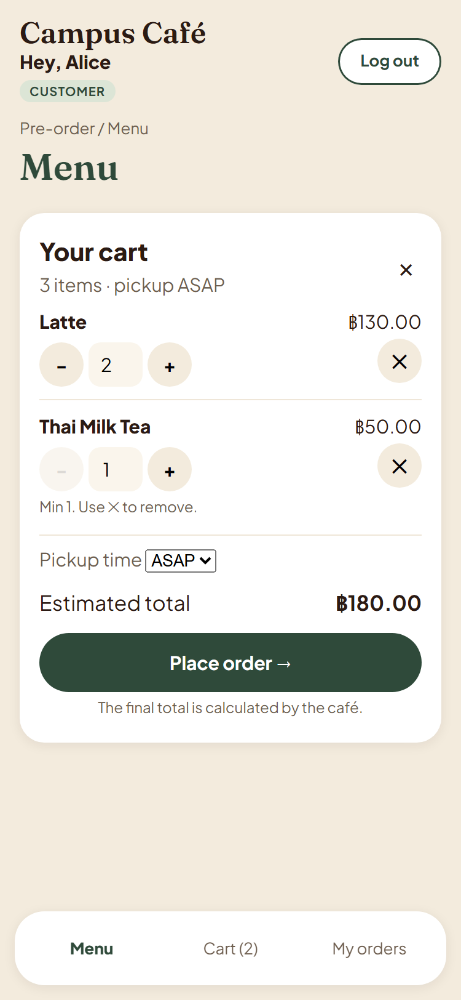
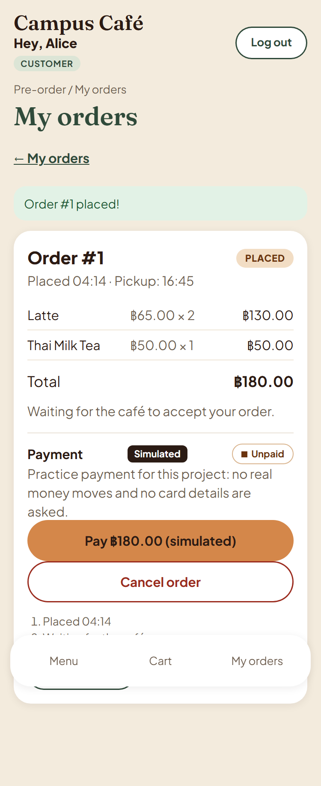

### Scenario 2 — Operator menu management and duplicate-name rejection (`F-05`, `FR-11`, `BR-08`)

| | |
|---|---|
| Scope / AC | `F-05` (`AC-5.1`..`AC-5.17`), business-rule rejection (`BR-08` case-insensitive unique item name, `400 VALIDATION_ERROR`) |
| Role / Start | `OPERATOR` (`staff@cafe.test`) on `/operator/menu` |
| Steps | Inspect existing items (`Latte` `฿65.00`, `Croissant` marked `Sold out` checkbox checked) -> click **Add item** -> submit duplicate name `"latte"` with price `50` |
| Expected & Actual | Menu list loads all items including sold-out items on desktop (`1280px`). Duplicate `"latte"` is rejected with `400 VALIDATION_ERROR` and `'A menu item named "Latte" already exists.'` shown inline under **Name** while preserving typed values `"latte"` and `"50"`. |

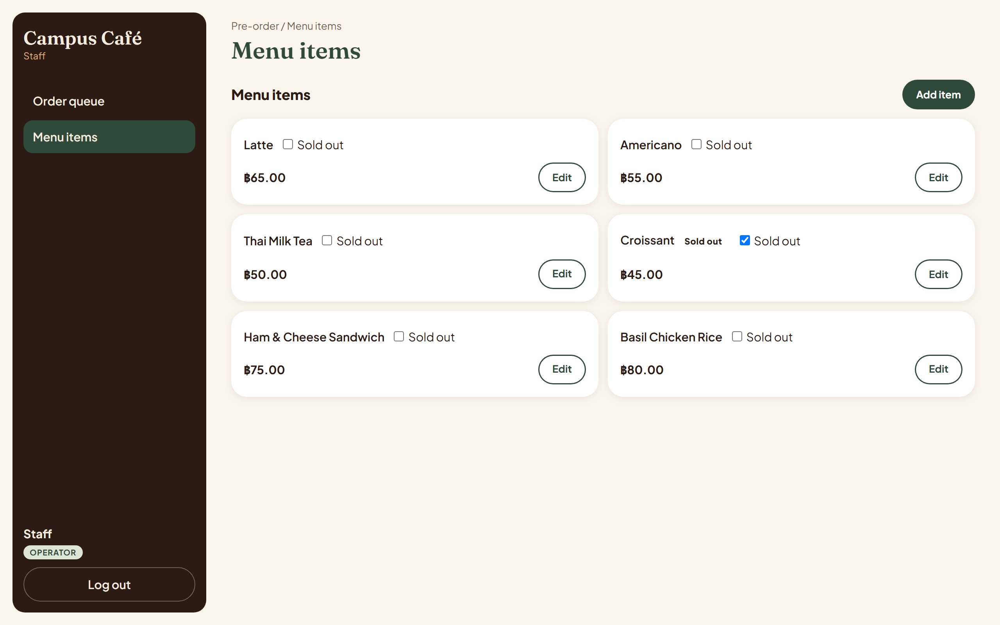
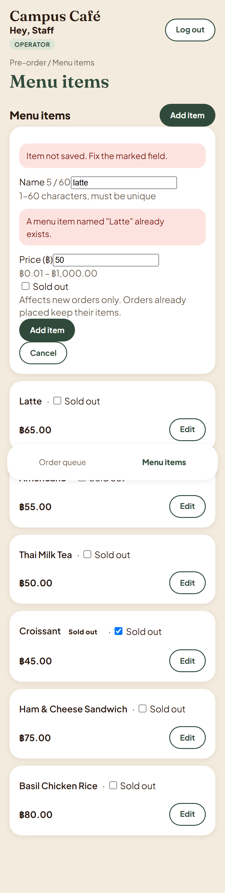

### Scenario 3 — Customer cancel confirmation & paid order reject + automatic refund (`F-06`, `BR-11`, `BR-12`, `BR-16`)

| | |
|---|---|
| Scope / AC | `F-06` (`FR-12`, `FR-13`, `BR-11`, `BR-12`) + `F-08` automatic refund on reject (`BR-16`, `AC-8.12`) |
| Role / Start | (a) `alice` viewing her `PLACED` order; (b) `alice` viewing her paid order after `staff` rejected it with `"Out of oat milk"` |
| Steps | (a) Click **Cancel order** to trigger confirmation dialog (`Keep order` / `Cancel order`); (b) Open rejected paid order on desktop split view |
| Expected & Actual | (a) Confirmation modal asks `Cancel order #2?` with safe left button **Keep order**; (b) Customer sees `REJECTED`, exact reason `"Out of oat milk"`, and `Refunded ฿65.00 ... (simulated), because the order was rejected.` (`BR-16`). |

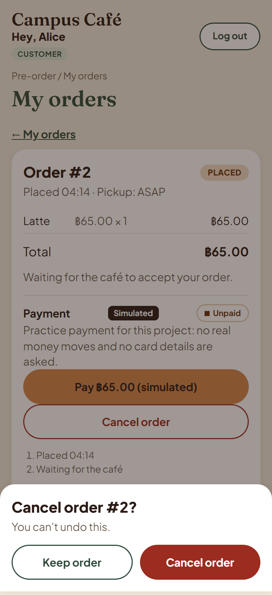
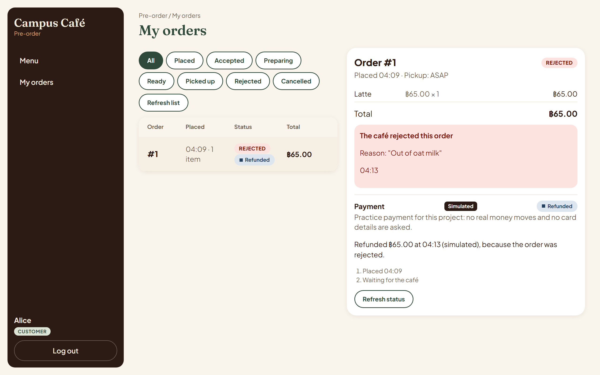

### Scenario 4 — Fulfilment queue & Paid-before-Pickup guard (`F-07`, `F-08 BR-15`, `#132`)

| | |
|---|---|
| Scope / AC | `F-07` (`FR-14`, `BR-13`) + `F-08` `BR-15` (`AC-8.17`: READY order requires `PAID` before `PICKED_UP`) + Lab 6 `#132` 7-column semantic table |
| Role / Start | `OPERATOR` (`staff@cafe.test`) on `/operator/orders?tab=ready` with 1 `READY + PAID` order (`#1` Alice) and 1 `READY + UNPAID` order (`#2` Bob) |
| Steps | Inspect `Ready` tab columns and buttons on desktop (`1280px`) |
| Expected & Actual | Table aligns all 7 columns (`Order`, `Status`, `Customer`, `Items`, `Placed`, `Total`, `Action`). `#1` (`■ Paid`) enables **Mark picked up**; `#2` (`■ Unpaid`) disables **Mark picked up** and displays `"Waiting for payment. The customer pays in the app."` |

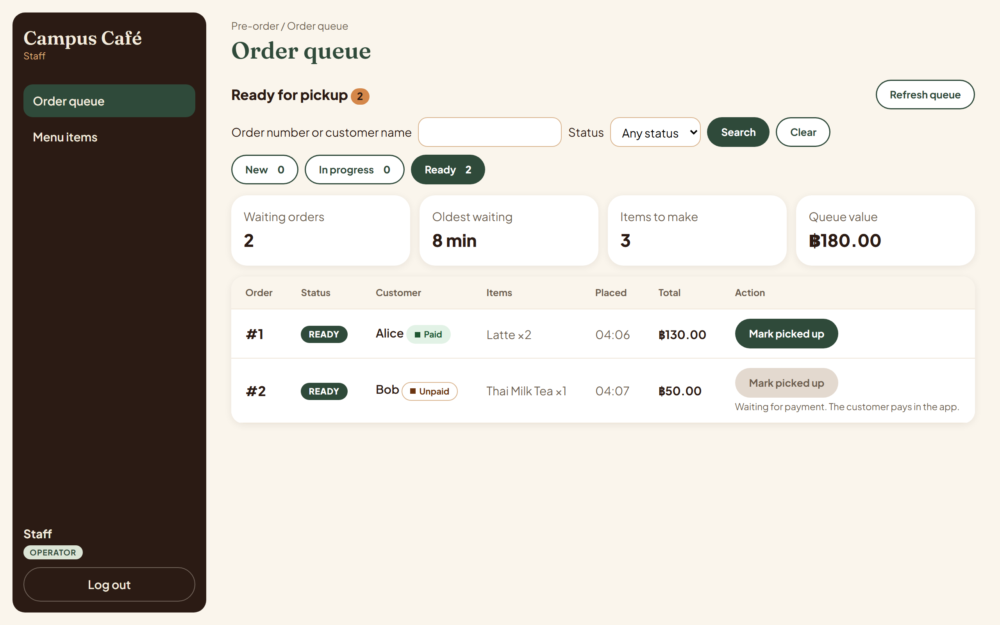

### Scenario 5 — Simulated payment persisted across reload (`F-08`, `FR-15`, `BR-14`)

| | |
|---|---|
| Scope / AC | `F-08` (`TEST-8.16`, `TEST-8.18`) — server-total simulated payment with zero card fields |
| Role / Start | `CUSTOMER` (`alice@cafe.test`) on `PREPARING` order `#1` (`฿130.00`) |
| Steps | Click **Pay ฿130.00 (simulated)** -> reload page (`F5`) |
| Expected & Actual | Payment card shows dark `Simulated` badge, project notice (`"no real money moves and no card details are asked"`), green `■ Paid` badge, and `"Paid ฿130.00 at ... (simulated)"` persisted after reload. |

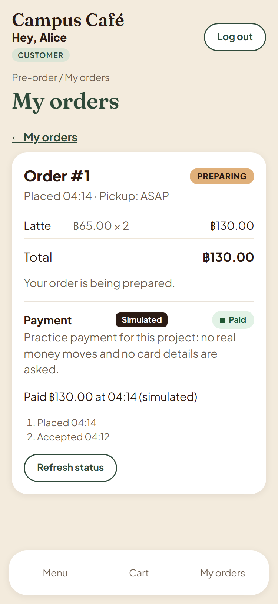

### Scenario 6 — Sprint 3 slot-capacity rejection (`F-09 BR-24`) & order search/filter (`F-11`)

| | |
|---|---|
| Scope / AC | **Sprint 3 rule enforcement** (`F-09 BR-24` max 10 active orders/slot, `409 INVALID_STATE`) + **Sprint 3 search & filter** (`F-11 FR-18`, `BR-25`..`BR-27`) |
| Role / Start | (a) `alice` selects open slot `16:30`; while cart is open, 10th order fills `16:30` in Postgres -> **Place order ->**; (b) `alice` on `/orders?status=READY`; (c) `staff` searches `q="ali"` + `Status="Ready"` |
| Expected & Actual | (a) Server rejects the 11th order with `409 INVALID_STATE` (`"This pickup slot is full. Pick another slot."`) while preserving Latte in cart; (b) URL query `?status=READY` filters customer orders cleanly; (c) Combined `q + status` returns only `#1` Alice (`READY`, `■ Paid`). |

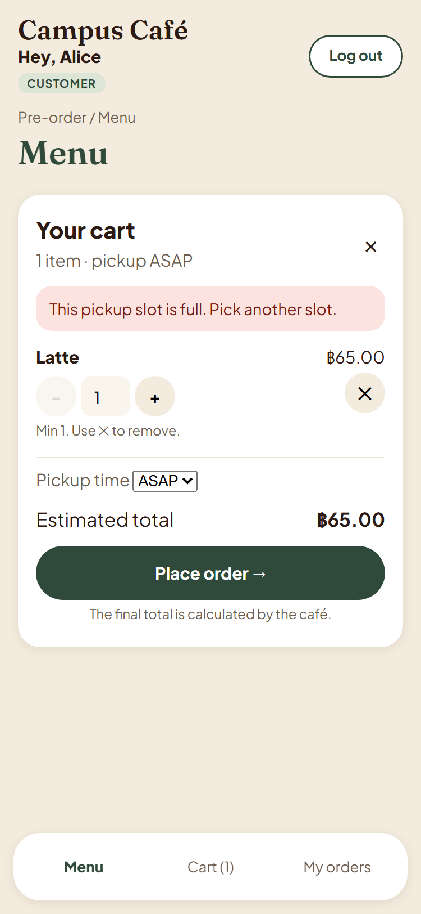
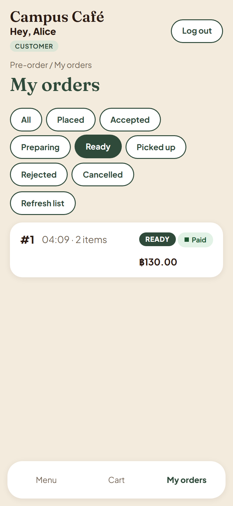
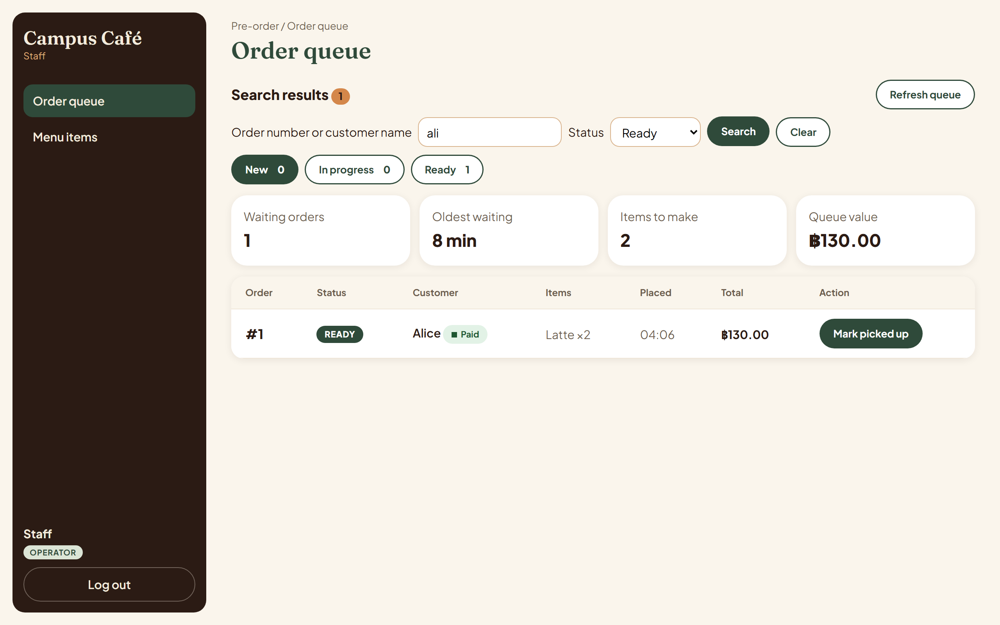

### Scenario 7 — Unauthorized route guard & real backend API access checks (`FR-04`, `NFR-02`, `NFR-03`)

Both the client router **and** the Express backend enforce role & ownership rules. In the browser, customer `alice` visiting `/operator/menu` is redirected to `/menu` with `"You don't have access to that page."`:

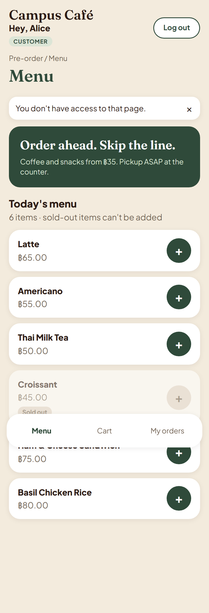

Direct HTTP calls executed against `http://localhost:3100` (with real Postgres sessions and cookies) prove the API enforces every guard regardless of client UI:

| Direct HTTP Probe | Status | Observed API Error Body (`{ error: { code, message, details } }`) |
|---|---|---|
| `GET /api/operator/menu` (no cookie / anonymous) | `401` | `{ "code": "UNAUTHENTICATED", "message": "Not logged in.", "details": null }` |
| `POST /api/operator/menu` (customer cookie `alice`) | `403` | `{ "code": "FORBIDDEN", "message": "You don't have access to this.", "details": null }` |
| `GET /api/operator/orders?q=ali` (customer cookie `alice`) | `403` | `{ "code": "FORBIDDEN", "message": "You don't have access to this.", "details": null }` |
| `POST /api/orders/:bobOrderId/pay` (customer `alice` -> `bob`'s order) | `404` | `{ "code": "NOT_FOUND", "message": "Order not found.", "details": null }` |
| `POST /api/orders/:bobOrderId/cancel` (customer `alice` -> `bob`'s order) | `404` | `{ "code": "NOT_FOUND", "message": "Order not found.", "details": null }` |
| `POST /api/orders` (`pickupSlot: "2026-11-27T10:20:00+07:00"`) | `400` | `{ "code": "VALIDATION_ERROR", "message": "Pick one of today's pickup slots.", "details": { "field": "pickupSlot" } }` |

## B.3 Build and automated test verification (`sprint2` synced with `main` `39bda5e`)

Ran cleanly in full after syncing `main` `39bda5e` (`PR #191`) into `sprint2`:

| Check / Suite | Command | Result | Scope / Notes |
|---|---|---|---|
| TypeScript & bundle build | `npm run build` | **Exit 0** | `prisma generate && tsc`, `tsc --noEmit && vite build` (`dist/assets/index-C1dZR_9Z.js`) |
| Server + Client Vitest | `npm test` | **185 passed, 0 failed** | `server`: **177 passed** (`15` test files, real Postgres 16 `cafe_s2_test`); `client`: **8 passed** (`4` unit test files) |
| Playwright E2E (phone + desktop) | `npx playwright test` | **67 passed, 7 skipped, 0 failed** | The `7` skipped tests are single-viewport Lab 6 regression checks (`TEST-L6-123/-129` phone-only; `TEST-L6-122/-124/-125/-126/-132` desktop-only) — zero skipped feature tests for Sprint 1/2/3 (`F-01`..`F-11`) |

For the two **selected test excerpts** (business rule `TEST-F09-02/03` and role access `TEST-F11-15`) and the **two Issue/PR chains** (`#146 -> #147` and `#157 -> #158`), see **Part D §5 and §6**.
